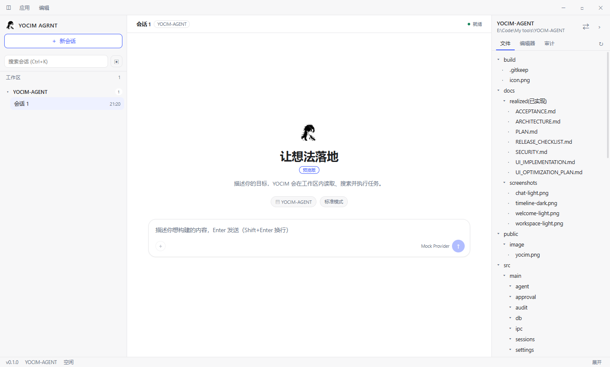
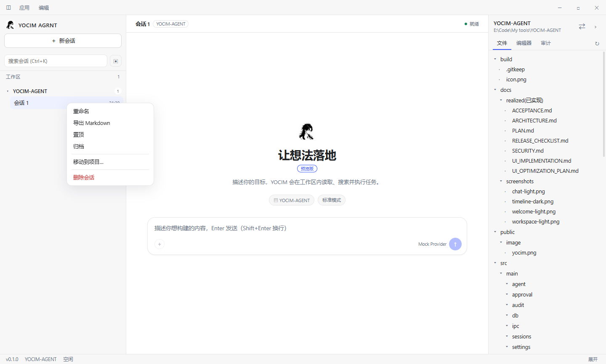
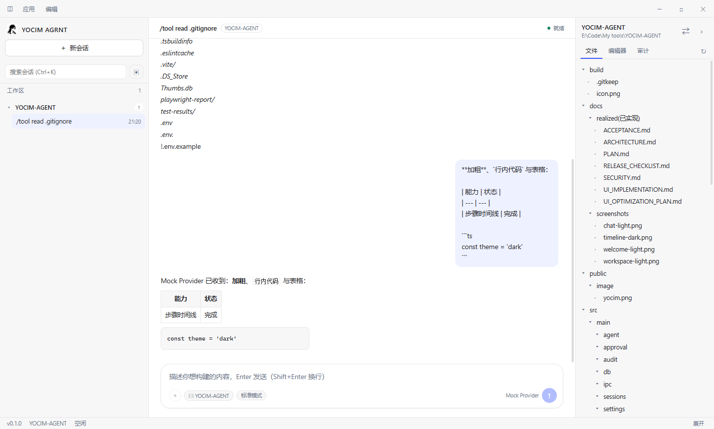

# YOCIM AGRNT

本地优先的桌面 AI 编程助手（Electron + Vue 3 + TypeScript）。可选择本地工作区，与模型对话，在审批后读取/修改文件并执行受控命令。

## 界面预览

三栏工作台：左侧项目化会话，中间纯会话区，右侧工作区面板（文件 / 编辑器 / 审计）。

### 欢迎态



### 会话右键菜单



### 深色模式与步骤时间线


### 助手 Markdown 渲染



### 工作区与 Monaco 编辑器


## 功能

- 无边框自定义标题栏：左上「应用 / 编辑」菜单，右上最小化 / 最大化 / 关闭；左栏顶部为品牌 Logo
- 三栏工作台：左侧项目化会话列表、中间纯会话区、右侧文件树 / Monaco / 审计；左右栏可折叠并在重启后保留
- 一个工作区 = 一个项目，同项目多会话；支持搜索、置顶、归档/取消归档、跨项目迁移
- 会话与项目操作收进右键菜单，避免行内小按钮堆叠
- 助手消息 Markdown 渲染（marked + DOMPurify）；工具调用以可展开步骤时间线展示，审批卡内联
- 浅色默认 + 纯黑深色主题；状态栏默认折叠为单行，可展开并持久化
- OpenAI-compatible 流式对话（默认 Mock Provider，可离线使用）
- 工具：`list_dir`、`read_file`、`search_files`、`write_file`（含补丁）、`run_command`
- 写文件与命令执行强制审批；路径守卫、命令白名单、危险命令拦截
- 审计日志与工具调用记录可查询（持久化 SQLite）
- 会话/消息/设置/项目状态持久化，重启恢复；会话重命名、删除、导出 Markdown
- 主进程文件日志与崩溃处理

## 界面与快捷键

- 左侧：顶部品牌与「新会话」按钮，下方搜索、工作区计数、置顶区与项目分组；右键会话可重命名 / 导出 / 置顶 / 归档 / 迁移 / 删除，右键项目可新建会话 / 重命名。
- 中间：空会话显示欢迎态与大输入卡；流式回复可停止；工具步骤折叠为「已执行 N 个步骤 · Xs」，展开查看参数与结果；审批卡内联并在待审批时自动展开；失败显示可重试错误卡。
- 右侧：文件 / 编辑器 / 审计三个 Tab；点击文件自动切到编辑器。
- 标题栏「应用」菜单：切换工作区、切换主题、设置；「编辑」菜单：新建会话、搜索会话、折叠工作区、状态栏。
- 快捷键（macOS 上为 `Cmd`）：

| 快捷键         | 作用              |
| -------------- | ----------------- |
| `Ctrl+B`       | 折叠 / 展开会话栏 |
| `Ctrl+Shift+B` | 折叠 / 展开工作区 |
| `Ctrl+N`       | 新建会话          |
| `Ctrl+K`       | 聚焦会话搜索      |
| `Ctrl+J`       | 展开 / 收起状态栏 |

## 环境要求

- Node.js >= 22.12（本仓库在 Node 24 / npm 11 验证）
- Windows 10+（主要验证平台）、macOS、Linux
- 无需原生编译工具链（数据库使用 Electron/Node 内置 `node:sqlite`）

## 安装与开发

```powershell
npm install
npm run dev
```

若 Electron 运行时下载失败（国内网络常见），使用镜像补齐：

```powershell
$env:ELECTRON_MIRROR='https://npmmirror.com/mirrors/electron/'
node node_modules/electron/install.js
```

常用脚本：

| 命令                  | 说明                                              |
| --------------------- | ------------------------------------------------- |
| `npm run dev`         | 启动开发窗口（Vite HMR）                          |
| `npm run typecheck`   | TypeScript / Vue 类型检查                         |
| `npm run lint`        | ESLint                                            |
| `npm run test`        | Vitest 单元测试                                   |
| `npm run build`       | 构建 main / preload / renderer                    |
| `npx playwright test` | Electron e2e 冒烟（需先 build）                   |
| `npm run e2e`         | build + e2e                                       |
| `npm run package`     | 生成当前平台安装包（输出到 `release/<version>/`） |
| `npm run package:dir` | 仅生成解包目录（调试打包）                        |

## 模型配置

默认使用 **Mock Provider**，不访问网络。支持 `/tool` 演示命令：

- `/tool read <path>`：调用 `read_file`（免审批）
- `/tool write <path>`：调用 `write_file`（触发审批）
- `/tool command <command>`：调用 `run_command`（触发审批）

接入真实模型：

1. 点击右上角「设置」；
2. Provider 选择 `OpenAI-compatible`；
3. 填写 Base URL（如 `https://api.example.com/v1`）、模型名与 API Key；
4. 保存后发送消息即可。

API Key 处理：

- 通过 Electron `safeStorage` 加密后存入 `settings.apiKeyEncrypted`，不会明文落库；
- 也可用环境变量 `OPENAI_API_KEY`（优先级高于本地存储）；
- renderer 只能读取 `hasApiKey`，无法拿到明文。

## 安全说明

- renderer 无 Node/fs/child_process 权限，只能经 preload 白名单 API 调用主进程；
- IPC handler 校验 `senderFrame` 来源，非应用页面返回 `E_FORBIDDEN`；
- 所有文件路径经 realpath 守卫，阻止 `..`、绝对路径、符号链接逃逸；
- 写文件/命令必须审批；命令受白名单与危险模式限制（超时 60s、输出截断 64KB）；
- 审计日志只追加，记录时间、工具、参数摘要、结果与审批状态；
- 详见 [docs/realized(已实现)/SECURITY.md](docs/realized%28已实现%29/SECURITY.md)。

## 数据位置

位于 Electron `userData` 目录（Windows 通常为 `%APPDATA%\YOCIM AGRNT`）：

- `yocim.db`：项目、会话、消息、工具调用、设置、审计
- `workspace.json`：上次打开的工作区
- `logs/main.log`：主进程日志（超过 2MB 轮转为 `main.old.log`）

## 打包

```powershell
$env:ELECTRON_MIRROR='https://npmmirror.com/mirrors/electron/'
$env:ELECTRON_BUILDER_BINARIES_MIRROR='https://npmmirror.com/mirrors/electron-builder-binaries/'
npm run package
```

- Windows 产物：`release/0.1.0/YOCIM AGRNT-0.1.0-x64-setup.exe` 与 `release/0.1.0/win-unpacked/`
- 应用图标：`build/icon.png`（由 `public/image/yocim.png` 复制）
- 当前未配置代码签名；安装时可能出现 SmartScreen 提示

发布前请按 [docs/realized(已实现)/RELEASE_CHECKLIST.md](docs/realized%28已实现%29/RELEASE_CHECKLIST.md) 执行检查。

## 文档

- 已实现阶段（归档）：
  - [UI_IMPLEMENTATION](docs/realized%28已实现%29/UI_IMPLEMENTATION.md)：三栏布局、项目化会话、时间线、主题与测试
  - [UI_OPTIMIZATION_PLAN](docs/realized%28已实现%29/UI_OPTIMIZATION_PLAN.md)：DeepSeek Harness 风格 UI 重构计划与验收
  - [PLAN](docs/realized%28已实现%29/PLAN.md)：范围、阶段、风险
  - [ARCHITECTURE](docs/realized%28已实现%29/ARCHITECTURE.md)：进程分层、IPC、事件协议、数据模型
  - [ACCEPTANCE](docs/realized%28已实现%29/ACCEPTANCE.md)：阶段与总验收清单
  - [SECURITY](docs/realized%28已实现%29/SECURITY.md)：威胁模型与安全边界
  - [RELEASE_CHECKLIST](docs/realized%28已实现%29/RELEASE_CHECKLIST.md)：发布检查清单

## 已知限制

- MVP 为单窗口单工作区；
- 工具步骤时间线为会话内存态，重启后恢复消息文本，工具调用记录可在审计面板查询；
- 默认为 Mock Provider，真实模型需要自备兼容端点；
- Monaco 全量语言包使 renderer 体积较大（后续可按需裁剪）；
- `node:sqlite` 仍标注为实验性 API，但随 Electron 45 / Node 24 内置可用；
- 未配置签名与公证，暂不适合直接面向最终用户分发。
