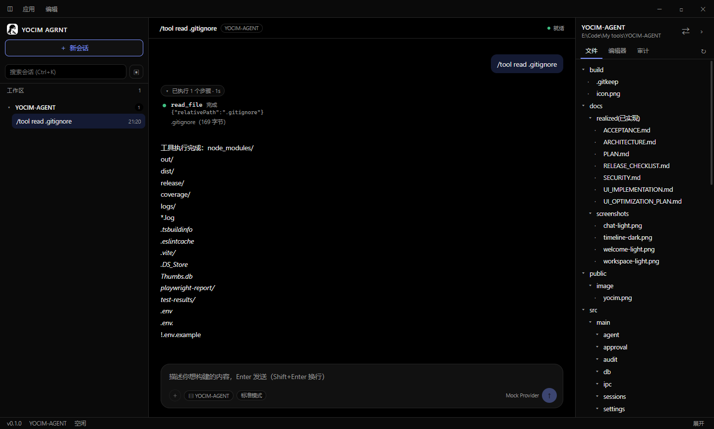
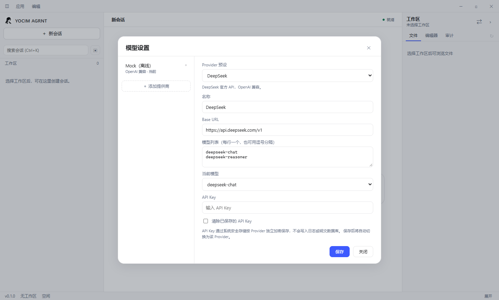
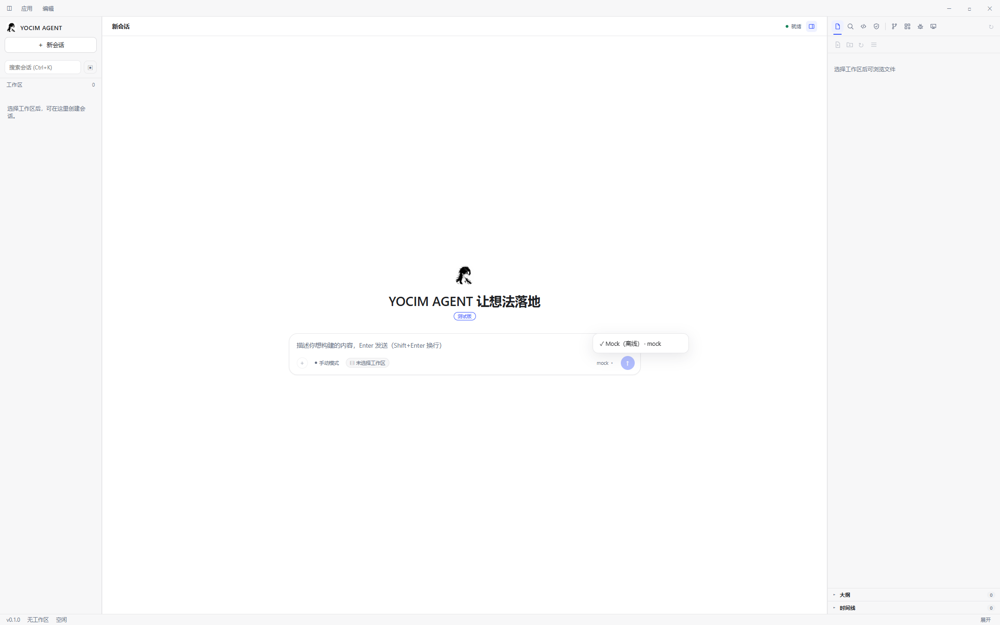
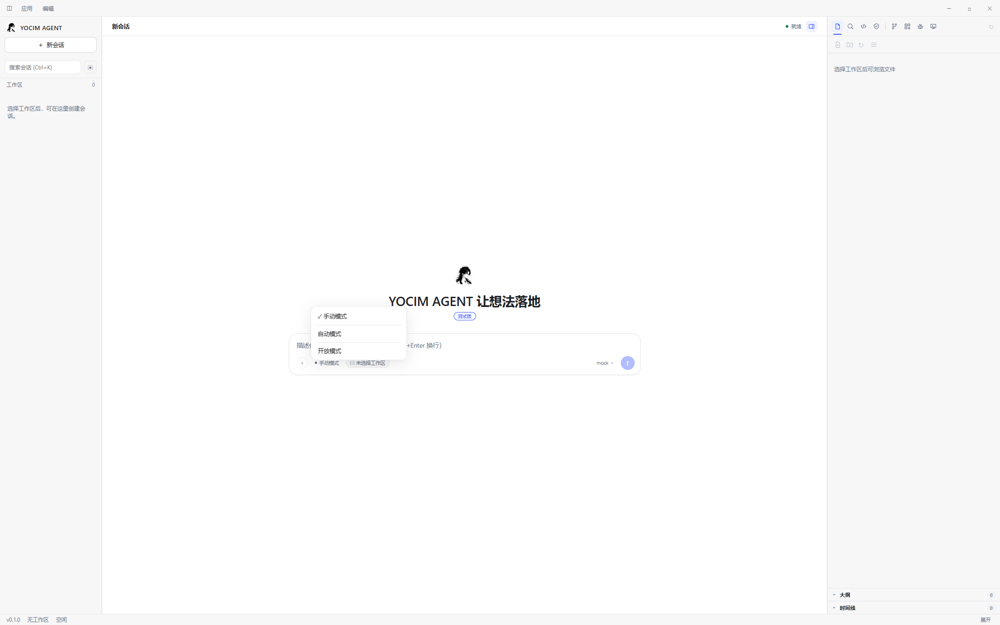

# YOCIM AGENT

本地优先的桌面 AI 编程助手（Electron + Vue 3 + TypeScript）。可选择本地工作区，与模型对话，在审批后读取/修改文件并执行受控命令。

## 界面预览

三栏工作台：左侧项目化会话，中间纯会话区，右侧工作区面板（8 个图标视图：文件 / 搜索 / 编辑器 / 审计 / 源代码管理 / 扩展 / 调试 / 远程）。

### 欢迎态


### 会话右键菜单


### 深色模式与步骤时间线



### 助手 Markdown 渲染


### 工作区与 Monaco 编辑器


### 多模型 Provider 设置



### 输入卡模型切换



### 审批模式



## 功能

- 多模型接入：DeepSeek、Qwen、BigModel、Kimi、MiniMax、腾讯云、阿里云、硅基流动、火山引擎、Claude、Gemini、Grok、本地 Ollama 与自定义端点；设置中添加，输入卡右下角切换
- 输入卡左下角审批模式：手动 / 自动 / 开放，切换后持久化
- 无边框自定义标题栏：左上「应用 / 编辑」菜单，右上最小化 / 最大化 / 关闭；左栏顶部为品牌 Logo
- 三栏工作台：左侧项目化会话列表、中间纯会话区、右侧图标活动栏（文件、搜索、编辑器、审计等 8 个视图）；左右栏可折叠、可拖动调宽，状态与宽度重启后保留
- 工作区全文搜索与替换：流式结果、取消、include/exclude、大小写/全词/正则、替换预览与 hash 冲突校验、时间线回滚（优先 ripgrep，缺失时回退内置搜索）
- Monaco 多标签编辑器：预览/固定标签、可编辑与 `Ctrl+S` 保存、脏状态、外部修改冲突（覆盖 / 重新加载 / 另存）、图片预览、选区「添加到对话」
- 一个工作区 = 一个项目，同项目多会话；支持搜索、置顶、归档/取消归档、跨项目迁移
- 会话与项目操作收进右键菜单，避免行内小按钮堆叠
- 助手消息 Markdown 渲染（marked + DOMPurify）；工具调用以可展开步骤时间线展示，审批卡内联
- 浅色默认 + 纯黑深色主题；状态栏默认折叠为单行，可展开并持久化
- OpenAI-compatible 流式对话（默认 Mock Provider，可离线使用）
- 工具：`list_dir`、`read_file`、`search_files`、`write_file`（含补丁）、`run_command`
- 写文件与命令执行强制审批；路径守卫、命令白名单、危险命令拦截
- 审计面板：统计卡（总调用/失败/批准/拒绝）、工具 / 结果 / 审批 / 时间范围 / 关键字筛选、详情抽屉（参数、结果、runId、callId、耗时）、实时模式、JSON / CSV 导出（持久化 SQLite，DB v4）
- 源代码管理：系统 Git 检测（缺失时提示安装）、已暂存 / 更改 / 未跟踪分组、暂存与取消暂存、提交与全部提交、Diff 阅读、分支切换与新建、拉取（`--ff-only`）/ 推送 / 发布分支、放弃更改二次确认、Git 输出面板（敏感信息脱敏）、活动栏变更数徽标
- 运行任务：自动识别 npm / pnpm / yarn 并列出 `package.json` scripts，`.yocim/tasks.json` 可配自定义命令；输出流式追加、可停止（杀进程树）、首次执行自定义命令需确认完整命令
- Node.js 调试：`.yocim/launch.json`（含 `${workspaceFolder}` / `${file}` / `${env:NAME}` 变量）与 `package.json` `main` 零配置启动；编辑器 glyph margin 断点与条件断点、继续 / 暂停 / 单步跳过 / 进入 / 跳出 / 重启 / 停止、变量树、监视表达式、调用堆栈、调试控制台、当前执行行高亮；首次启动确认完整命令，输出脱敏
- 扩展管理（第一层，不执行扩展代码）：本地目录 / `.vsix` / VS Code 扩展目录导入、启用禁用、卸载、详情与理由；兼容性分级「仅声明式 / 部分兼容 / 不兼容」，不兼容扩展默认禁用；声明式片段贡献会注册为编辑器补全
- 会话/消息/设置/项目状态持久化，重启恢复；会话重命名、删除、导出 Markdown
- 主进程文件日志与崩溃处理

## 界面与快捷键

- 左侧：顶部品牌与「新会话」按钮，下方搜索、工作区计数、置顶区与项目分组；右键会话可重命名 / 导出 / 置顶 / 归档 / 迁移 / 删除，右键项目可新建会话 / 重命名。
- 中间：空会话显示欢迎态与大输入卡；流式回复可停止；工具步骤折叠为「已执行 N 个步骤 · Xs」，展开查看参数与结果；审批卡内联并在待审批时自动展开；失败显示可重试错误卡。
- 右侧：8 个图标视图（文件、搜索、编辑器、审计、源代码管理、扩展、运行调试、远程）；点击文件自动切到编辑器，搜索命中可跳转并选中。
- 左右栏之间的分隔条可拖动调节宽度，双击恢复默认；聚焦分隔条后也可用方向键微调。
- 标题栏「应用」菜单：切换工作区、切换主题、设置；「编辑」菜单：新建会话、搜索会话、折叠工作区、状态栏。
- 快捷键（macOS 上为 `Cmd`）：

| 快捷键         | 作用               |
| -------------- | ------------------ |
| `Ctrl+B`       | 折叠 / 展开会话栏  |
| `Ctrl+Shift+B` | 折叠 / 展开工作区  |
| `Ctrl+N`       | 新建会话           |
| `Ctrl+K`       | 聚焦会话搜索       |
| `Ctrl+J`       | 展开 / 收起状态栏  |
| `Ctrl+S`       | 保存当前编辑器文件 |

## 审批模式

输入卡左下角可切换 Agent 工具审批模式，切换后写入设置并在重启后保留：

| 模式     | 行为                                 |
| -------- | ------------------------------------ |
| 手动模式 | 写文件与命令执行都需要审批（默认）   |
| 自动模式 | 自动批准写文件，命令执行仍需审批     |
| 开放模式 | 自动批准写文件与命令，不再弹出审批卡 |

开放模式仍受工作区路径守卫、命令白名单与危险命令拦截约束，审批模式不会绕过这些安全边界。

## 环境要求

- Node.js >= 22.12（本仓库在 Node 24 / npm 11 验证）
- Windows 10+（主要验证平台）、macOS、Linux
- 无需原生编译工具链（数据库使用 Electron/Node 内置 `node:sqlite`）

## 安装与开发

```powershell
npm install
npm run dev
```

若 Electron 运行时下载失败（国内网络常见），使用镜像补齐：

```powershell
$env:ELECTRON_MIRROR='https://npmmirror.com/mirrors/electron/'
node node_modules/electron/install.js
```

常用脚本：

| 命令                  | 说明                                              |
| --------------------- | ------------------------------------------------- |
| `npm run dev`         | 启动开发窗口（Vite HMR）                          |
| `npm run typecheck`   | TypeScript / Vue 类型检查                         |
| `npm run lint`        | ESLint                                            |
| `npm run test`        | Vitest 单元测试                                   |
| `npm run build`       | 构建 main / preload / renderer                    |
| `npx playwright test` | Electron e2e 冒烟（需先 build）                   |
| `npm run e2e`         | build + e2e                                       |
| `npm run package`     | 生成当前平台安装包（输出到 `release/<version>/`） |
| `npm run package:dir` | 仅生成解包目录（调试打包）                        |

## 模型配置

默认使用 **Mock Provider**，不访问网络。支持 `/tool` 演示命令：

- `/tool read <path>`：调用 `read_file`（免审批）
- `/tool write <path>`：调用 `write_file`（触发审批）
- `/tool command <command>`：调用 `run_command`（触发审批）

接入真实模型：

1. 点击标题栏「应用」→「设置…」；
2. 点击「添加提供商」，选择预设（DeepSeek / Qwen / BigModel / Kimi / MiniMax / 腾讯云 / 阿里云 / 硅基流动 / 火山引擎 / Claude / Gemini / Grok / 本地 Ollama / 自定义）；
3. 按需调整 Base URL、模型列表与 API Key，保存后自动切换为该 Provider；
4. 在中间输入卡右下角的模型按钮中切换 Provider / 模型。

内置端点：

| Provider         | Base URL                                            | 协议                        |
| ---------------- | --------------------------------------------------- | --------------------------- |
| DeepSeek         | `https://api.deepseek.com/v1`                       | OpenAI 兼容                 |
| Qwen（通义千问） | `https://dashscope.aliyuncs.com/compatible-mode/v1` | OpenAI 兼容                 |
| BigModel（智谱） | `https://open.bigmodel.cn/api/paas/v4`              | OpenAI 兼容                 |
| Kimi（Moonshot） | `https://api.moonshot.cn/v1`                        | OpenAI 兼容                 |
| MiniMax          | `https://api.minimaxi.com/v1`                       | OpenAI 兼容                 |
| 腾讯云（混元）   | `https://api.hunyuan.cloud.tencent.com/v1`          | OpenAI 兼容                 |
| 阿里云（百炼）   | `https://dashscope.aliyuncs.com/compatible-mode/v1` | OpenAI 兼容                 |
| 硅基流动         | `https://api.siliconflow.cn/v1`                     | OpenAI 兼容                 |
| 火山引擎（方舟） | `https://ark.cn-beijing.volces.com/api/v3`          | OpenAI 兼容                 |
| Claude           | `https://api.anthropic.com/v1`                      | Anthropic Messages          |
| Gemini           | `https://generativelanguage.googleapis.com/v1beta`  | Gemini GenerateContent      |
| Grok             | `https://api.x.ai/v1`                               | OpenAI 兼容                 |
| 本地 Ollama      | `http://localhost:11434/v1`                         | OpenAI 兼容（无需 Key）     |
| 自定义           | 自行填写                                            | OpenAI / Anthropic / Gemini |

API Key 处理：

- 每个 Provider 的 Key 独立通过 Electron `safeStorage` 加密后存入 `settings`，不会明文落库；
- 也可用环境变量回退（如 `DEEPSEEK_API_KEY`、`DASHSCOPE_API_KEY`、`ANTHROPIC_API_KEY`、`GEMINI_API_KEY`、`XAI_API_KEY` 等）；
- renderer 只能读取 `hasApiKey`，无法拿到明文。

## 安全说明

- renderer 无 Node/fs/child_process 权限，只能经 preload 白名单 API 调用主进程；
- IPC handler 校验 `senderFrame` 来源，非应用页面返回 `E_FORBIDDEN`；
- 所有文件路径经 realpath 守卫，阻止 `..`、绝对路径、符号链接逃逸；
- 写文件/命令必须审批；命令受白名单与危险模式限制（超时 60s、输出截断 64KB）；
- 审计日志只追加，记录时间、工具、参数摘要、结果与审批状态；
- Git 操作全部经主进程 `GitService` 以参数数组 `spawn('git', args)` 调用，不经过 shell；不提供 force push、不跳过 hooks（无 `--no-verify`），拉取默认 `--ff-only`，Git 输出日志对 URL 凭据与 token 脱敏，应用不保存 Git 凭据（交给系统 Git Credential Manager）；
- 任务与调试启动同样以参数数组 `spawn`（Windows 上 `.cmd`/`.bat` 经 `cmd.exe /d /s /c` 包裹），自定义任务与启动配置首次执行都要用户确认完整命令；`launch.json` 的 `program`/`cwd` 不得越出工作区，调试输出与命令日志统一脱敏、单任务输出上限 512KB、最多 4 个并发任务；
- 扩展第一层**不执行任何扩展代码**：只解析 `yocim-extension.json` / VS Code `package.json` 的声明式贡献；VSIX 用内置最小 zip 读取器解包，拒绝 zip64 与路径穿越，声明了 `main`/`browser`、`debuggers` 或扩展依赖的扩展判为「不兼容」并保持禁用；
- 详见 [docs/realized(已实现)/SECURITY.md](docs/realized%28已实现%29/SECURITY.md)。

## 数据位置

位于 Electron `userData` 目录（Windows 通常为 `%APPDATA%\YOCIM AGENT`）：

- `yocim.db`：项目、会话、消息、工具调用、设置、审计
- `workspace.json`：上次打开的工作区
- `logs/main.log`：主进程日志（超过 2MB 轮转为 `main.old.log`）

## 打包

```powershell
$env:ELECTRON_MIRROR='https://npmmirror.com/mirrors/electron/'
$env:ELECTRON_BUILDER_BINARIES_MIRROR='https://npmmirror.com/mirrors/electron-builder-binaries/'
npm run package
```

- Windows 产物：`release/0.1.0/YOCIM AGENT-0.1.0-x64-setup.exe` 与 `release/0.1.0/win-unpacked/`
- 应用图标：`build/icon.png`（由 `public/image/yocim.png` 复制）
- 当前未配置代码签名；安装时可能出现 SmartScreen 提示

发布前请按 [docs/realized(已实现)/RELEASE_CHECKLIST.md](docs/realized%28已实现%29/RELEASE_CHECKLIST.md) 执行检查。

## 文档

- [右侧工作区增强计划](docs/WORKSPACE_PANEL_PLAN.md)：图标活动栏、文件/搜索/Git/扩展/调试/远程
- [多模型 Provider 接入方案](docs/realized%28已实现%29/MULTI_PROVIDER_PLAN.md)：Provider 调研、协议、数据模型与实施记录
- 已实现阶段（归档）：
  - [UI_IMPLEMENTATION](docs/realized%28已实现%29/UI_IMPLEMENTATION.md)：三栏布局、项目化会话、时间线、主题与测试
  - [UI_OPTIMIZATION_PLAN](docs/realized%28已实现%29/UI_OPTIMIZATION_PLAN.md)：DeepSeek Harness 风格 UI 重构计划与验收
  - [PLAN](docs/realized%28已实现%29/PLAN.md)：范围、阶段、风险
  - [ARCHITECTURE](docs/realized%28已实现%29/ARCHITECTURE.md)：进程分层、IPC、事件协议、数据模型
  - [ACCEPTANCE](docs/realized%28已实现%29/ACCEPTANCE.md)：阶段与总验收清单
  - [SECURITY](docs/realized%28已实现%29/SECURITY.md)：威胁模型与安全边界
  - [RELEASE_CHECKLIST](docs/realized%28已实现%29/RELEASE_CHECKLIST.md)：发布检查清单

## 已知限制

- MVP 为单窗口单工作区；
- 工具步骤时间线为会话内存态，重启后恢复消息文本，工具调用记录可在审计面板查询；
- 默认为 Mock Provider，真实模型需要自备兼容端点；
- Monaco 全量语言包使 renderer 体积较大（后续可按需裁剪）；
- `node:sqlite` 仍标注为实验性 API，但随 Electron 45 / Node 24 内置可用；
- 调试只支持 Node.js（launch，不含 attach），协议是自研 CDP 适配器而非 DAP；运行输出为只读面板，不提供终端与 stdin 交互；
- 扩展仅第一层：不执行扩展代码，语法/主题贡献只展示不生效，命令/菜单/快捷键未接入命令面板；
- 未配置签名与公证，暂不适合直接面向最终用户分发。
