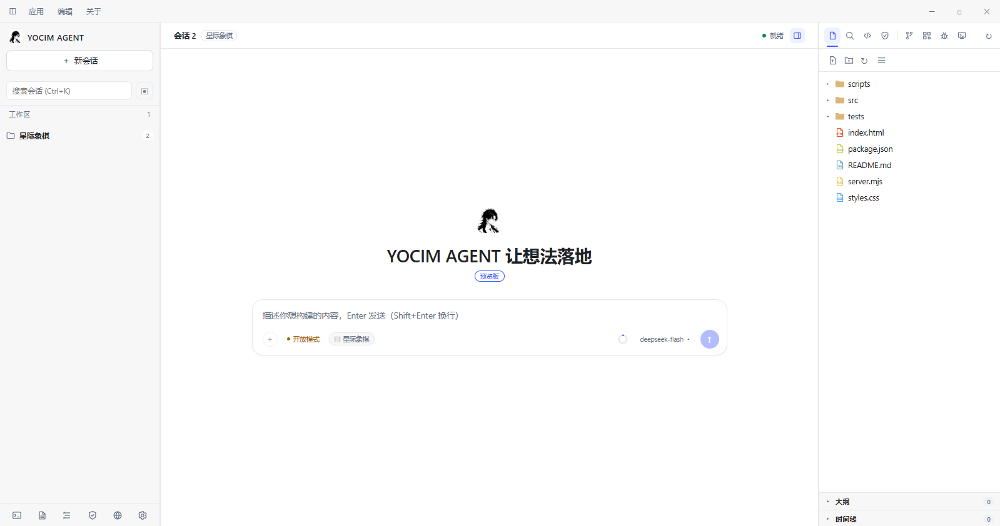

# YOCIM AGENT

[English](README.md) | [中文](README.zh-CN.md)

本地优先的桌面 AI 编程助手（Electron + Vue 3 + TypeScript）。可选择本地工作区，与模型对话，在审批后读取/修改文件并执行受控命令。



## 功能

- **多模型接入**：DeepSeek、Qwen、BigModel、Kimi、MiniMax、腾讯云、阿里云、硅基流动、火山引擎、ChatGPT、Claude、Gemini、Grok、本地 Ollama 与自定义端点；设置中添加，输入卡右下角切换（按服务商分组，只显示模型名，选中项右侧为绿色实心圆）
- **分栏设置**：账单、模型、搜索、生图、外观、存储、浏览器；审批模式（手动 / 自动 / 开放）在输入卡左下角切换并持久化
- **三栏工作台**：左侧项目化会话、中间纯会话区、右侧 8 个图标视图（文件 / 搜索 / 编辑器 / 审计 / 源代码管理 / 扩展 / 调试 / 远程）；左右栏可折叠、可拖动调宽，状态重启后保留
- **AI 可操作浏览器**：会话区下半屏工具区提供「终端 / 浏览器」双 tab（共享可拖拽高度）；Agent 通过薄 CDP 原语（`browser_cdp` / `browser_wait`）驱动内嵌可见的 Chromium 视图——导航、截图、读标题/DOM、坐标级输入、条件等待。视图内可折叠控制台汇聚 Console / Network / 未处理异常 / append-only 操作审计，并提供暂停 AI / 接管 / 恢复入口。浏览器上下文按会话隔离，Runtime.evaluate 与 Node/Electron 隔离。
- **全文搜索与替换**：流式结果、取消、include/exclude、大小写 / 全词 / 正则、替换预览与 hash 冲突校验、时间线回滚（优先 ripgrep，缺失时回退内置搜索）
- **Monaco 多标签编辑器**：预览 / 固定标签、`Ctrl+S` 保存、脏状态、外部修改冲突（覆盖 / 重新加载 / 另存）、图片预览、选区「添加到对话」
- **项目与会话**：一个工作区 = 一个项目，同项目多会话；搜索、置顶、归档 / 取消归档、跨项目迁移；会话与项目操作收进右键菜单
- **助手消息**：Markdown 渲染（marked + DOMPurify）；工具调用以可展开步骤时间线展示，审批卡内联；浅色默认 + 纯黑深色主题，状态栏默认折叠为单行、可展开
- **审批体验**：写文件审批卡内置着色 diff 预览（edit_file 多块补丁一次预览全部改动）；「会话内允许 / 项目内允许」记住规则跳过同类审批（白名单与危险命令拦截不可被规则绕过，审计记录规则名）；审批通过后校验文件未被外部修改
- **任务计划**：Agent 用 `update_plan` 维护计划卡（待办 / 进行中 / 完成 + 进度条），轮次用尽自动暂停可一键继续；轮次上限自适应（只读 6 / 单文件 20 / 多文件 60）
- **上下文管理**：输入卡用量圆环（悬停看已用/窗口，点击压缩）；接近窗口 80% 自动压缩旧内容为结构化摘要（超 95% 硬裁剪）；窗口默认 200K，可在模型菜单调 200K–1000K；思考强度可调（默认 / 低 / 中 / 高，按协议映射）；对话流（含工具调用与结果）持久化到 SQLite，跨轮次完整回放，压缩只影响发给模型的内容；只读工具并发（上限 4），写工具与命令串行
- **项目规则注入**：`AGENTS.md` / `.yocim/rules.md` 优先于默认习惯，轻量 repo map 让模型首轮了解目录结构；当前打开与未保存文件随请求注入
- **工具**：`list_dir`（glob + 大小/行数）、`read_file`（行号 + offset/limit 分页）、`search_files`（ripgrep，正则 / include / exclude / 上下文行）、`write_file`、`edit_file`（多块原子补丁 + 缩进容错）、`run_command`（白名单 + `.yocim/commands.json` 扩展，流式输出）、`run_tests`（识别 vitest/jest/pytest/go）、`run_typecheck` / `run_lint`（file:line:col）、`get_git_diff`、`update_plan`（结构化计划，每轮回传模型）
- **审计面板**：统计卡（总调用 / 失败 / 批准 / 拒绝）、工具 / 结果 / 审批 / 时间 / 关键字筛选、详情抽屉、实时模式、JSON / CSV 导出（SQLite，DB v4）
- **源代码管理**：系统 Git 检测（缺失时提示安装）、暂存 / 更改 / 未跟踪分组、暂存与提交、分支切换 / 新建、拉取（`--ff-only`）/ 推送 / 发布分支、Diff 阅读、放弃更改二次确认、输出脱敏、变更数徽标
- **图形化提交图**：竖线轨道 + 状态圆点（合并空心、HEAD 光晕），分支 / 远程 / 标签胶囊，conventional 前缀着色；点击提交展开改动文件清单与增删行，再点收起
- **运行任务**：自动识别 npm / pnpm / yarn 并列出 scripts，`.yocim/tasks.json` 可配自定义命令；输出流式追加、可停止（杀进程树）、首次执行需确认完整命令
- **Node.js 调试**：`.yocim/launch.json`（支持 `${workspaceFolder}` / `${file}` / `${env:NAME}`）或 `package.json` `main` 零配置启动；断点与条件断点、单步、变量树、监视、调用堆栈、调试控制台、当前行高亮；首次启动确认命令，输出脱敏
- **远程工作区（WSL / SSH）**：目标管理与环境探测，连接后直接在右侧面板浏览 / 编辑 / 搜索 / Git / 运行；WSL 走 `\\wsl.localhost` UNC + `wsl.exe --exec`，SSH 走内置 `ssh2`（SFTP + exec），指纹 TOFU 校验、口令 `safeStorage` 加密
- **扩展管理（第一层）**：不执行扩展代码；本地目录 / `.vsix` / VS Code 扩展目录导入、启用禁用、卸载、详情；兼容性分级「仅声明式 / 部分兼容 / 不兼容」，不兼容默认禁用；声明式片段注册为编辑器补全
- **持久化**：会话 / 消息 / 设置 / 项目状态重启恢复；会话重命名、删除、导出 Markdown；主进程文件日志与崩溃处理

## 界面与快捷键

- 左侧：顶部品牌与「新会话」，下方搜索、工作区计数、置顶区与项目分组；右键会话可重命名 / 导出 / 置顶 / 归档 / 迁移 / 删除，右键项目可新建会话 / 重命名。
- 中间：空会话显示欢迎态与大输入卡；流式回复可停止；工具步骤折叠为「已执行 N 个步骤 · Xs」，展开查看参数与结果；失败显示可重试错误卡。
- 右侧：8 个图标视图；点击文件自动切到编辑器，搜索命中可跳转选中。分隔条可拖动调宽、双击恢复默认、聚焦后方向键微调。
- 标题栏「应用」菜单：切换工作区 / 主题、设置；「编辑」菜单：新建会话、搜索会话、折叠工作区、状态栏。

| 快捷键         | 作用               |
| -------------- | ------------------ |
| `Ctrl+B`       | 折叠 / 展开会话栏  |
| `Ctrl+Shift+B` | 折叠 / 展开工作区  |
| `Ctrl+N`       | 新建会话           |
| `Ctrl+K`       | 聚焦会话搜索       |
| `Ctrl+J`       | 展开 / 收起状态栏  |
| `Ctrl+S`       | 保存当前编辑器文件 |

> macOS 上将 `Ctrl` 换成 `Cmd`。

## 审批模式

| 模式     | 行为                                 |
| -------- | ------------------------------------ |
| 手动模式 | 写文件与命令执行都需要审批（默认）   |
| 自动模式 | 自动批准写文件，命令执行仍需审批     |
| 开放模式 | 自动批准写文件与命令，不再弹出审批卡 |

开放模式仍受路径守卫、命令白名单与危险命令拦截约束，审批模式不会绕过这些安全边界。

## 环境要求

- Node.js >= 22.12（本仓库在 Node 24 / npm 11 验证）
- Windows 10+（主要验证平台）、macOS、Linux
- 无需原生编译工具链（数据库使用 Electron/Node 内置 `node:sqlite`）

## 安装与开发

```powershell
npm install
npm run dev
```

若 Electron 运行时下载失败（国内网络常见），使用镜像补齐：

```powershell
$env:ELECTRON_MIRROR='https://npmmirror.com/mirrors/electron/'
node node_modules/electron/install.js
```

| 命令                  | 说明                                              |
| --------------------- | ------------------------------------------------- |
| `npm run dev`         | 启动开发窗口（Vite HMR）                          |
| `npm run typecheck`   | TypeScript / Vue 类型检查                         |
| `npm run lint`        | ESLint                                            |
| `npm run test`        | Vitest 单元测试                                   |
| `npm run build`       | 构建 main / preload / renderer                    |
| `npx playwright test` | Electron e2e 冒烟（需先 build）                   |
| `npm run e2e`         | build + e2e                                       |
| `npm run package`     | 生成当前平台安装包（输出到 `release/<version>/`） |
| `npm run package:dir` | 仅生成解包目录（调试打包）                        |

## 模型配置

默认使用 **Mock Provider**，不访问网络，支持演示命令：`/tool read <path>`（免审批）、`/tool write <path>` 与 `/tool command <command>`（触发审批）。

接入真实模型：标题栏「应用」→「设置…」→「模型」→「添加提供商」，选择预设后填写 Base URL、模型列表与 API Key；保存后自动切换。输入卡右下角模型按钮可随时切换 Provider / 模型。

内置端点：

| Provider          | Base URL                                            | 协议                        |
| ----------------- | --------------------------------------------------- | --------------------------- |
| DeepSeek          | `https://api.deepseek.com/v1`                       | OpenAI 兼容                 |
| Qwen（通义千问）  | `https://dashscope.aliyuncs.com/compatible-mode/v1` | OpenAI 兼容                 |
| BigModel（智谱）  | `https://open.bigmodel.cn/api/paas/v4`              | OpenAI 兼容                 |
| Kimi（Moonshot）  | `https://api.moonshot.cn/v1`                        | OpenAI 兼容                 |
| MiniMax           | `https://api.minimaxi.com/v1`                       | OpenAI 兼容                 |
| 腾讯云（混元）    | `https://api.hunyuan.cloud.tencent.com/v1`          | OpenAI 兼容                 |
| 阿里云（百炼）    | `https://dashscope.aliyuncs.com/compatible-mode/v1` | OpenAI 兼容                 |
| 硅基流动          | `https://api.siliconflow.cn/v1`                     | OpenAI 兼容                 |
| 火山引擎（方舟）  | `https://ark.cn-beijing.volces.com/api/v3`          | OpenAI 兼容                 |
| ChatGPT（OpenAI） | `https://api.openai.com/v1`                         | OpenAI 兼容                 |
| Claude            | `https://api.anthropic.com/v1`                      | Anthropic Messages          |
| Gemini            | `https://generativelanguage.googleapis.com/v1beta`  | Gemini GenerateContent      |
| Grok              | `https://api.x.ai/v1`                               | OpenAI 兼容                 |
| 本地 Ollama       | `http://localhost:11434/v1`                         | OpenAI 兼容（无需 Key）     |
| 自定义            | 自行填写                                            | OpenAI / Anthropic / Gemini |

设置分页：账单（DeepSeek 余额 + 按 provider/模型统计 token 用量、手填单价估算费用）、模型、搜索（Tavily Key，开启后多出 `web_search`，没配 Key 则该工具不出现）、生图（智谱 Key，默认免费 `cogview-3-flash`，开启后多出 `generate_image`，可切自定义 OpenAI 图像格式端点）、外观（主题 / 字号 / 自动换行 / 代码缩略图）、存储（查看与自定义数据目录，重启生效）、浏览器（开关浏览器工具、无头模式、空闲回收、Runtime.evaluate、以及带风险提示的显式复用日常 profile 选项）。

API Key 处理：每个 Provider 的 Key 独立经 Electron `safeStorage` 加密后存入 `settings`，不明文落库；renderer 只能读 `hasApiKey`。也支持环境变量回退（`DEEPSEEK_API_KEY`、`DASHSCOPE_API_KEY`、`OPENAI_API_KEY`、`ANTHROPIC_API_KEY`、`GEMINI_API_KEY`、`XAI_API_KEY`、`TAVILY_API_KEY`、`ZHIPU_API_KEY` 等）。

## 安全说明

- renderer 无 Node/fs/child_process 权限，只能经 preload 白名单 API 调用主进程；IPC handler 校验 `senderFrame`，非应用页面返回 `E_FORBIDDEN`。
- 所有文件路径经 realpath 守卫，阻止 `..`、绝对路径与符号链接逃逸；写文件/命令必须审批，命令受白名单与危险模式限制（超时 60s、输出截断 64KB）。
- 审计日志只追加，记录时间、工具、参数摘要、结果与审批状态。
- Git 操作经主进程 `GitService` 以参数数组 `spawn('git', args)` 调用，不经 shell；不提供 force push、不跳过 hooks，拉取默认 `--ff-only`，输出对 URL 凭据与 token 脱敏，凭据交给系统 Git Credential Manager。
- 任务与调试同样以参数数组 `spawn`（Windows 上 `.cmd`/`.bat` 经 `cmd.exe /d /s /c` 包裹），自定义任务与启动配置首次执行需确认；`launch.json` 的 `program`/`cwd` 不得越出工作区；输出统一脱敏，单任务上限 512KB，最多 4 个并发任务。
- 远程工作区：WSL 经 `wsl.exe --exec`、参数按数组传递；SSH 用内置 `ssh2`，支持私钥 / 密码 / ssh-agent，口令仅在 `safeStorage` 加密保存（renderer 只知 `hasSecret`），主机指纹 TOFU 首次确认、变化即阻断，远端路径做 `..` 穿越校验；远程调试与批量替换在 UI 层显式禁用。
- 扩展第一层**不执行任何扩展代码**：只解析声明式贡献；VSIX 用内置最小 zip 读取器解包，拒绝 zip64 与路径穿越；声明 `main`/`browser`、`debuggers` 或扩展依赖者判为「不兼容」并保持禁用。

## 数据位置

位于 Electron `userData` 目录（Windows 通常为 `%APPDATA%\YOCIM AGENT`）：

- `yocim.db`：项目、会话、消息、工具调用、设置、审计、token 用量
- `workspace.json`：上次打开的工作区
- `logs/main.log`：主进程日志（超过 2MB 轮转为 `main.old.log`）

「设置 → 存储」可改自定义目录（数据库、日志、时间线快照、扩展一起搬），改动需重启生效。

## 打包

```powershell
$env:ELECTRON_MIRROR='https://npmmirror.com/mirrors/electron/'
$env:ELECTRON_BUILDER_BINARIES_MIRROR='https://npmmirror.com/mirrors/electron-builder-binaries/'
npm run package
```

- Windows 产物：`release/0.1.6/YOCIM AGENT-0.1.6-setup.exe` 与 `release/0.1.6/win-unpacked/`
- 内置 ripgrep：`resources/ripgrep/rg.exe`（14.1.1）经 `extraResources` 放入，缺失时回退 PATH 的 `rg` 与内置 JS 搜索
- 运行依赖：`zod` 与 `ssh2`（含 `asn1` / `bcrypt-pbkdf` / `tweetnacl` / `safer-buffer`）外置并打进 asar；`cpu-features` 为可选原生加速依赖，未编译也不打包；`npmRebuild: false` 规避路径含空格时 node-gyp 失败
- 应用图标：`build/icon.png`（由 `public/image/yocim.png` 复制）；当前未配置代码签名，安装时可能出现 SmartScreen 提示

## 许可证

本项目采用 Apache License 2.0，详见 [LICENSE](LICENSE) 与 [NOTICE](NOTICE)。
