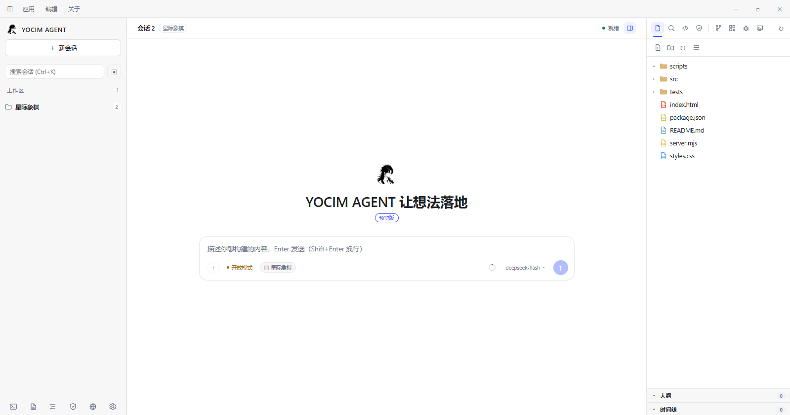

# YOCIM AGENT

[English](../README.md) | [中文](README.zh-CN.md) | [日本語](README.ja.md) | [한국어](README.ko.md) | [Español](README.es.md) | [Português (Brasil)](README.pt-BR.md)

Un asistente de programación con IA de escritorio, local-first (Electron + Vue 3 + TypeScript). Elige un espacio de trabajo local, chatea con un modelo y deja que lea y modifique archivos y ejecute comandos controlados después de tu aprobación.



## Características

- **Compatibilidad con múltiples modelos**: DeepSeek, Qwen, BigModel, Kimi, MiniMax, Tencent Cloud, Alibaba Cloud, SiliconFlow, Volcano Engine, ChatGPT, Claude, Gemini, Grok, Ollama local y endpoints personalizados. Añádelos en Ajustes y cámbialos desde la esquina inferior derecha del compositor (agrupados por proveedor, solo el nombre del modelo, y el elemento seleccionado marcado con un círculo verde relleno).
- **Seis idiomas**: chino simplificado, inglés, japonés, coreano, español y portugués de Brasil. El primer arranque pide un idioma y luego abre los ajustes de Modelos para guiarte a introducir una API Key; esto solo ocurre una vez. Puedes cambiarlo en cualquier momento en Ajustes → Apariencia → Idioma de la interfaz (se aplica al instante, sin reiniciar).
- **Ajustes con pestañas**: Facturación, Modelos, Búsqueda, Generación de imágenes, Apariencia, Almacenamiento y Navegador. El modo de aprobación (Manual / Auto / Abierto) se alterna en la esquina inferior izquierda del compositor y se conserva.
- **Espacio de trabajo de tres paneles**: lista de sesiones por proyecto a la izquierda, un área de chat pura en el centro y una barra de actividad con 8 vistas a la derecha (Archivos / Búsqueda / Editor / Auditoría / Control de código fuente / Extensiones / Depuración / Remoto). Los paneles laterales se pueden contraer y redimensionar arrastrando, y su estado se conserva entre reinicios.
- **Navegador operable por IA**: el área de herramientas inferior de la columna de chat tiene pestañas Terminal / Navegador (con altura redimensionable compartida). El agente controla una vista Chromium integrada y visible mediante primitivas CDP ligeras (`browser_cdp` / `browser_wait`): navegar, capturar pantalla, leer DOM/título, enviar coordenadas de entrada y esperar condiciones. Una consola dentro de la vista agrega Console / Network / excepciones / una auditoría de acciones de solo añadido, con controles para pausar la IA / tomar el control / reanudar. Los contextos del navegador están aislados por sesión, y Runtime.evaluate está aislado en un entorno aislado respecto de Node/Electron.
- **Búsqueda y reemplazo en todo el espacio de trabajo**: resultados en streaming, cancelación, incluir/excluir, opciones de mayúsculas/palabra completa/regex, vista previa del reemplazo con comprobación de conflictos de hash y línea de tiempo con reversión (primero ripgrep, con retroceso al motor de búsqueda integrado).
- **Editor multipestaña Monaco**: pestañas de vista previa/fijadas, guardado con `Ctrl+S`, estado de cambios sin guardar, conflictos por cambios externos (sobrescribir / recargar / guardar como), vista previa de imágenes y "Añadir al chat" desde una selección.
- **Proyectos y sesiones**: un espacio de trabajo = un proyecto, con múltiples sesiones por proyecto; busca, fija, archiva/desarchiva y mueve entre proyectos. Las acciones de sesión y proyecto están en los menús contextuales.
- **Mensajes del asistente**: renderizado Markdown (marked + DOMPurify); las llamadas a herramientas se muestran como líneas de tiempo de pasos expandibles, con tarjetas de aprobación en línea. Tema claro por defecto y además un tema oscuro negro puro; la barra de estado se contrae a una sola línea por defecto y se puede expandir.
- **Experiencia de aprobación**: las tarjetas de aprobación de escritura de archivos incluyen una vista previa del diff con resaltado de sintaxis (todos los bloques de un parche de `edit_file` a la vez). Las reglas "Permitir en la sesión / Permitir en el proyecto" omiten aprobaciones idénticas futuras (los comandos permitidos y los peligrosos no se pueden eludir con reglas; el nombre de la regla se registra en el registro de auditoría). Los archivos se vuelven a comprobar para detectar modificaciones externas antes de la ejecución.
- **Planificación de tareas**: el agente mantiene una tarjeta de plan sobre el chat mediante `update_plan` (por hacer / en curso / hecho + barra de progreso). Al alcanzar el límite de rondas, la ejecución se pausa automáticamente y se puede reanudar con un clic. Los límites de rondas son adaptativos (6 de solo lectura / 20 de un solo archivo / 60 de varios archivos).
- **Gestión de contexto**: un anillo de uso a la izquierda del botón de modelo (pasa el cursor para ver usado/ventana, haz clic para compactar manualmente). El contenido antiguo se compacta automáticamente en un resumen estructurado al 80% de la ventana (recorte forzado por encima del 95%). La ventana es de 200K por defecto y se puede ajustar de 200K a 1000K en el menú del modelo; también se puede ajustar el esfuerzo de razonamiento (por defecto / bajo / medio / alto, mapeado por protocolo). Los flujos de conversación del lado del modelo (incluidas las llamadas a herramientas y sus resultados) se guardan en SQLite y se reproducen por completo entre rondas: la compactación solo afecta a lo que se envía al modelo, nunca al historial del chat. Las herramientas de solo lectura se ejecutan en paralelo (hasta 4), mientras que las herramientas de escritura y los comandos se ejecutan en serie.
- **Reglas del proyecto e inyección de estructura**: `AGENTS.md` / `.yocim/rules.md` tienen prioridad sobre los hábitos por defecto, y un mapa ligero del repositorio ayuda al modelo a entender la estructura de directorios en el primer turno. Los archivos abiertos y sin guardar se inyectan en cada solicitud.
- **Herramientas**: `list_dir` (filtrado glob + tamaño/número de líneas de archivo), `read_file` (números de línea + paginación por offset/limit), `search_files` (ripgrep, regex / incluir / excluir / líneas de contexto), `write_file`, `edit_file` (parches atómicos de varios bloques con tolerancia a la indentación), `run_command` (lista de permitidos + extensiones de `.yocim/commands.json`, salida en streaming), `run_tests` (detecta automáticamente vitest/jest/pytest/go), `run_typecheck` / `run_lint` (formato compacto archivo:línea:columna), `get_git_diff`, `update_plan` (plan estructurado que se devuelve al modelo en cada ronda).
- **Panel de auditoría**: tarjetas de estadísticas (llamadas totales / fallidas / aprobadas / denegadas), filtros por herramienta / resultado / aprobación / rango de tiempo / palabra clave, cajón de detalles, modo en vivo y exportación a JSON/CSV (guardado en SQLite, DB v4).
- **Control de código fuente**: detección del Git del sistema (con una sugerencia de instalación si falta), grupos de preparados / modificados / sin seguimiento, preparar y confirmar, cambiar/crear rama, pull (`--ff-only`) / push / publicar, visor de diff, segunda confirmación para descartar cambios, salida de Git redactada y una insignia con el número de cambios.
- **Gráfico de confirmaciones gráfico**: carriles verticales con puntos de estado (huecos para las confirmaciones de fusión, con brillo para HEAD), cápsulas de rama / remoto / etiqueta unidas a sus confirmaciones y coloreado por prefijo convencional. Haz clic en una confirmación para expandir su lista de archivos modificados con recuentos de inserciones/eliminaciones; vuelve a hacer clic para contraer.
- **Ejecutar tareas**: detecta automáticamente npm / pnpm / yarn y lista los scripts de `package.json`; `.yocim/tasks.json` puede definir comandos personalizados. La salida se transmite de forma incremental, las tareas se pueden detener (matando el árbol de procesos) y un comando personalizado debe confirmarse por completo en la primera ejecución.
- **Depuración de Node.js**: inicio sin configuración desde `.yocim/launch.json` (con variables `${workspaceFolder}` / `${file}` / `${env:NAME}`) o `main` de `package.json`. Puntos de interrupción y puntos de interrupción condicionales en el margen del editor, continuar / pausar / paso a paso por encima / dentro / fuera / reiniciar / detener, árbol de variables, expresiones de seguimiento, pila de llamadas, consola de depuración y resaltado de la línea actual. El comando completo debe confirmarse en el primer inicio; la salida se redacta.
- **Espacios de trabajo remotos (WSL / SSH)**: gestiona destinos y sonda entornos, y luego explora / edita / busca / usa Git / ejecuta tareas directamente en el panel derecho. WSL usa rutas UNC `\\wsl.localhost` más `wsl.exe --exec`; SSH usa el `ssh2` integrado (SFTP + exec), con verificación de huella de host TOFU y contraseñas cifradas mediante `safeStorage`.
- **Extensiones (primera capa)**: no se ejecuta ningún código de extensión. Importa desde directorios locales / `.vsix` / el directorio de extensiones de VS Code, habilita/deshabilita, desinstala y consulta detalles. La compatibilidad se clasifica como "solo declarativa / parcial / incompatible", con las extensiones incompatibles deshabilitadas por defecto. Las contribuciones declarativas de snippets se registran como autocompletados del editor.
- **Persistencia**: las sesiones / mensajes / ajustes / estado del proyecto sobreviven a los reinicios; las sesiones se pueden renombrar, eliminar y exportar a Markdown. Registro de archivos en el proceso principal y manejo de fallos.

## Interfaz y atajos de teclado

- **Izquierda**: la marca y "Nueva sesión" arriba, luego búsqueda, recuento de espacios de trabajo, sección de fijados y grupos de proyectos. Haz clic derecho en una sesión para renombrar / exportar / fijar / archivar / mover / eliminar; haz clic derecho en un proyecto para crear una sesión / renombrar.
- **Centro**: las sesiones vacías muestran un estado de bienvenida y un compositor grande; las respuestas en streaming se pueden detener; los pasos de herramientas se contraen en "N pasos ejecutados · Xs" y se expanden para mostrar argumentos y resultados; los fallos muestran una tarjeta de error con opción de reintentar.
- **Derecha**: las 8 vistas con icono; al hacer clic en un archivo se cambia al editor, y se puede saltar a un resultado de búsqueda y seleccionarlo. El divisor se puede arrastrar para redimensionar, hacer doble clic para restablecer o ajustar con las teclas de flecha cuando tiene el foco.
- **Barra de título**: el menú "Aplicación" cambia el espacio de trabajo / el tema y abre Ajustes; el menú "Editar" crea/busca sesiones, contrae el espacio de trabajo y alterna la barra de estado. El idioma está en Ajustes → Apariencia.

| Atajo          | Acción                                   |
| -------------- | ---------------------------------------- |
| `Ctrl+B`       | Alternar la barra lateral de sesiones    |
| `Ctrl+Shift+B` | Alternar el panel del espacio de trabajo |
| `Ctrl+N`       | Nueva sesión                             |
| `Ctrl+K`       | Enfocar la búsqueda de sesiones          |
| `Ctrl+J`       | Expandir / contraer la barra de estado   |
| `Ctrl+S`       | Guardar el archivo actual del editor     |

> En macOS, usa `Cmd` en lugar de `Ctrl`.

## Modos de aprobación

| Modo    | Comportamiento                                                                                 |
| ------- | ---------------------------------------------------------------------------------------------- |
| Manual  | Tanto la escritura de archivos como los comandos requieren aprobación (por defecto)            |
| Auto    | La escritura de archivos se aprueba automáticamente; los comandos siguen preguntando           |
| Abierto | La escritura de archivos y los comandos se aprueban automáticamente, sin tarjeta de aprobación |

El modo Abierto sigue estando limitado por la protección de rutas del espacio de trabajo, la lista de comandos permitidos y el bloqueo de comandos peligrosos: los modos de aprobación nunca eluden estos límites de seguridad.

## Requisitos

- Node.js >= 22.12 (verificado en este repositorio con Node 24 / npm 11)
- Windows 10+ (plataforma de validación principal), macOS y Linux
- No se requiere un conjunto de herramientas de compilación nativa (la base de datos usa el `node:sqlite` integrado de Electron/Node)

## Instalación y desarrollo

```powershell
npm install
npm run dev
```

Si falla la descarga del entorno de ejecución de Electron (habitual en algunas redes), rellénala usando un espejo:

```powershell
$env:ELECTRON_MIRROR='https://npmmirror.com/mirrors/electron/'
node node_modules/electron/install.js
```

| Comando               | Descripción                                                          |
| --------------------- | -------------------------------------------------------------------- |
| `npm run dev`         | Iniciar la ventana de desarrollo (Vite HMR)                          |
| `npm run typecheck`   | Comprobación de tipos de TypeScript / Vue                            |
| `npm run lint`        | ESLint                                                               |
| `npm run test`        | Pruebas unitarias de Vitest                                          |
| `npm run build`       | Compilar main / preload / renderer                                   |
| `npx playwright test` | Pruebas de humo e2e de Electron (compila primero)                    |
| `npm run e2e`         | Compilar + e2e                                                       |
| `npm run package`     | Crear un instalador para la plataforma actual (`release/<version>/`) |
| `npm run package:dir` | Crear solo un directorio sin empaquetar (depuración del empaquetado) |

## Configuración del modelo

El **Mock Provider** se usa por defecto y no realiza solicitudes de red. Comandos de demostración: `/tool read <path>` (sin aprobación), `/tool write <path>` y `/tool command <command>` (activan la aprobación).

Para conectar un modelo real: barra de título "Aplicación" → "Ajustes…" → "Modelos" → "Añadir proveedor", elige un preajuste y luego completa la Base URL, la lista de modelos y la API key. Al guardar se cambia automáticamente a ese proveedor. Usa el botón de modelo en la esquina inferior derecha del compositor para cambiar de proveedor/modelo en cualquier momento.

Endpoints integrados:

| Proveedor        | Base URL                                            | Protocolo                       |
| ---------------- | --------------------------------------------------- | ------------------------------- |
| DeepSeek         | `https://api.deepseek.com/v1`                       | Compatible con OpenAI           |
| Qwen (Tongyi)    | `https://dashscope.aliyuncs.com/compatible-mode/v1` | Compatible con OpenAI           |
| BigModel (Zhipu) | `https://open.bigmodel.cn/api/paas/v4`              | Compatible con OpenAI           |
| Kimi (Moonshot)  | `https://api.moonshot.cn/v1`                        | Compatible con OpenAI           |
| MiniMax          | `https://api.minimaxi.com/v1`                       | Compatible con OpenAI           |
| Tencent Cloud    | `https://api.hunyuan.cloud.tencent.com/v1`          | Compatible con OpenAI           |
| Alibaba Cloud    | `https://dashscope.aliyuncs.com/compatible-mode/v1` | Compatible con OpenAI           |
| SiliconFlow      | `https://api.siliconflow.cn/v1`                     | Compatible con OpenAI           |
| Volcano Engine   | `https://ark.cn-beijing.volces.com/api/v3`          | Compatible con OpenAI           |
| ChatGPT (OpenAI) | `https://api.openai.com/v1`                         | Compatible con OpenAI           |
| Claude           | `https://api.anthropic.com/v1`                      | Anthropic Messages              |
| Gemini           | `https://generativelanguage.googleapis.com/v1beta`  | Gemini GenerateContent          |
| Grok             | `https://api.x.ai/v1`                               | Compatible con OpenAI           |
| Ollama local     | `http://localhost:11434/v1`                         | Compatible con OpenAI (sin key) |
| Personalizado    | Introduce el tuyo                                   | OpenAI / Anthropic / Gemini     |

Pestañas de Ajustes: Facturación (saldo de DeepSeek + uso de tokens por proveedor/modelo con precios unitarios introducidos a mano), Modelos, Búsqueda (clave de Tavily: habilita `web_search`; la herramienta se oculta cuando no hay clave configurada), Generación de imágenes (clave de Zhipu, `cogview-3-flash` gratis por defecto: habilita `generate_image`, con una opción para un endpoint personalizado en formato de imágenes de OpenAI), Apariencia (tema / tamaño de fuente / ajuste de línea / minimapa de código), Almacenamiento (ver y cambiar el directorio de datos, efectivo tras reiniciar) y Navegador (activar/desactivar las herramientas de navegador de IA, modo headless, reciclaje por inactividad, Runtime.evaluate y la opción explícita de reutilizar tu perfil diario con una advertencia de riesgo).

Manejo de las API keys: la clave de cada proveedor se cifra con `safeStorage` de Electron antes de guardarse en `settings`; nunca en texto plano; el renderer solo puede leer `hasApiKey`. También se admiten variables de entorno como alternativa (`DEEPSEEK_API_KEY`, `DASHSCOPE_API_KEY`, `OPENAI_API_KEY`, `ANTHROPIC_API_KEY`, `GEMINI_API_KEY`, `XAI_API_KEY`, `TAVILY_API_KEY`, `ZHIPU_API_KEY`, etc.).

## Seguridad

- El renderer no tiene acceso a Node/fs/child_process y solo puede llamar al proceso principal a través de la lista de permitidos del preload; los manejadores IPC validan `senderFrame` y devuelven `E_FORBIDDEN` para páginas que no son de la aplicación.
- Todas las rutas de archivos pasan por una protección realpath que bloquea `..`, las rutas absolutas y las salidas por enlaces simbólicos. La escritura de archivos y los comandos requieren aprobación, y los comandos están restringidos por una lista de permitidos y comprobaciones de patrones peligrosos (tiempo de espera de 60s, truncado de salida a 64KB).
- El registro de auditoría es de solo añadido y registra la hora, la herramienta, el resumen de argumentos, el resultado y el estado de aprobación.
- Las operaciones de Git pasan por el `GitService` del proceso principal usando `spawn('git', args)` sin shell. Sin push forzado, sin omitir hooks, el pull usa `--ff-only` por defecto, la salida de Git se redacta para URLs/credenciales/tokens y las credenciales se delegan al Git Credential Manager del sistema.
- Las tareas y las sesiones de depuración también usan `spawn` con arrays de argumentos (en Windows, `.cmd`/`.bat` se envuelven con `cmd.exe /d /s /c`). Las tareas personalizadas y las configuraciones de inicio deben confirmarse por completo en la primera ejecución; `program`/`cwd` de `launch.json` no pueden escapar del espacio de trabajo; la salida se redacta, con un límite de 512KB por tarea y como máximo 4 tareas concurrentes.
- Espacios de trabajo remotos: WSL se ejecuta mediante `wsl.exe --exec` con argumentos en array y sin shell. SSH usa el `ssh2` integrado con autenticación por clave privada / contraseña / ssh-agent; los secretos solo se guardan cifrados con `safeStorage` (el renderer solo conoce `hasSecret`); las huellas de host se verifican con TOFU en el primer uso y se bloquean si cambian; las rutas remotas se comprueban para evitar el recorrido con `..`. La depuración remota y el reemplazo masivo están deshabilitados explícitamente en la interfaz.
- La primera capa de extensiones **no ejecuta ningún código de extensión**: solo se analizan las contribuciones declarativas. Los archivos VSIX se descomprimen con un lector zip mínimo integrado que rechaza zip64 y el recorrido de rutas; las extensiones que declaran `main`/`browser`, `debuggers` o dependencias de extensiones se marcan como "incompatibles" y permanecen deshabilitadas.

## Ubicación de los datos

Dentro del directorio `userData` de Electron (en Windows, normalmente `%APPDATA%\YOCIM AGENT`):

- `yocim.db`: proyectos, sesiones, mensajes, llamadas a herramientas, ajustes, auditoría y uso de tokens
- `workspace.json`: el último espacio de trabajo abierto
- `logs/main.log`: registro del proceso principal (rota a `main.old.log` cuando supera los 2MB)

"Ajustes → Almacenamiento" puede apuntar a un directorio personalizado (la base de datos, los registros, las instantáneas de la línea de tiempo y las extensiones se mueven juntas); el cambio se aplica tras reiniciar.

## Empaquetado

```powershell
$env:ELECTRON_MIRROR='https://npmmirror.com/mirrors/electron/'
$env:ELECTRON_BUILDER_BINARIES_MIRROR='https://npmmirror.com/mirrors/electron-builder-binaries/'
npm run package
```

- Artefactos de Windows: `release/0.1.9/YOCIM.AGENT-0.1.9-x64-setup.exe` y `release/0.1.9/win-unpacked/`
- ripgrep incluido: binarios 14.1.1 descargados por CI en `resources/ripgrep/` antes del empaquetado y copiados mediante `extraResources`; las compilaciones locales pueden colocar `rg`/`rg.exe` allí manualmente (ignorado por git) o definir `YOCIM_RIPGREP_PATH`. Si falta, se recurre a `rg` del PATH y a la búsqueda JS integrada
- Dependencias en tiempo de ejecución: `zod` y `ssh2` (con `asn1` / `bcrypt-pbkdf` / `tweetnacl` / `safer-buffer`) están externalizadas y empaquetadas en el asar; `cpu-features` es un acelerador nativo opcional que no se compila ni se empaqueta; `npmRebuild: false` evita errores de node-gyp cuando la ruta del proyecto contiene espacios
- Iconos de la aplicación: `build/icon.png` (Windows / Linux, copiado de `public/image/yocim.png`) y `build/icon.icns` (macOS). La firma de código aún no está configurada, así que SmartScreen puede mostrar una advertencia durante la instalación.

## Licencia

Licencia MIT. Consulta [LICENSE](../LICENSE).
