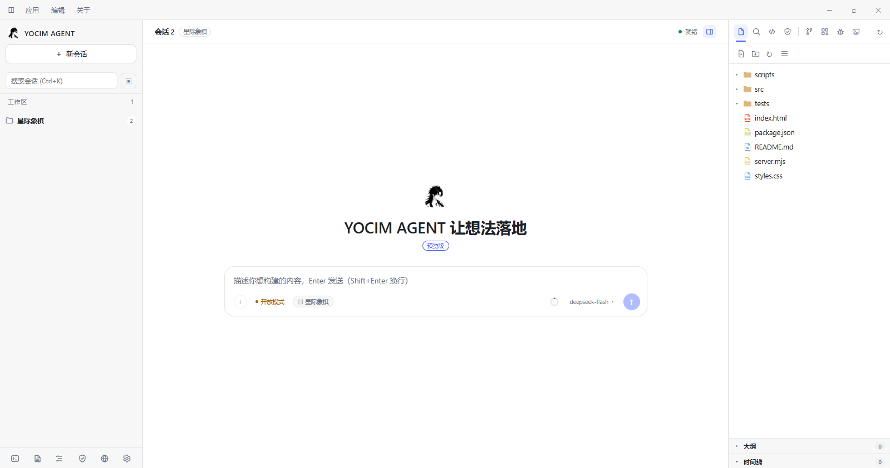

# YOCIM AGENT

[English](../README.md) | [中文](README.zh-CN.md) | [日本語](README.ja.md) | [한국어](README.ko.md) | [Español](README.es.md) | [Português (Brasil)](README.pt-BR.md)

ローカルファーストのデスクトップ AI コーディングアシスタントです（Electron + Vue 3 + TypeScript）。ローカルのワークスペースを選択してモデルとチャットし、承認を得たうえでファイルの読み取り／変更や制御されたコマンドの実行を行えます。



## 機能

- **マルチモデル対応**: DeepSeek、Qwen、BigModel、Kimi、MiniMax、Tencent Cloud、Alibaba Cloud、SiliconFlow、Volcano Engine、ChatGPT、Claude、Gemini、Grok、ローカルの Ollama、およびカスタムエンドポイントに対応します。設定で追加し、入力欄の右下から切り替えられます（プロバイダーごとにグループ化され、表示はモデル名のみ、選択中の項目には緑の塗りつぶし円が付きます）。
- **6 言語対応**: 簡体字中国語、英語、日本語、韓国語、スペイン語、ブラジルポルトガル語。初回起動時に言語を選択すると、続いてモデル設定が開き、API Key の入力を案内します。この処理は 1 回だけです。設定 → 外観 → インターフェース言語でいつでも変更できます（再起動不要で即時反映）。
- **タブ式の設定**: 請求、モデル、検索、画像生成、外観、ストレージ、ブラウザ。承認モード（手動 / 自動 / オープン）は入力欄の左下で切り替えられ、状態が保持されます。
- **3 ペインのワークスペース**: 左側はプロジェクト単位のセッション一覧、中央は純粋なチャットエリア、右側は 8 ビューのアイコンアクティビティバー（ファイル / 検索 / エディター / 監査 / ソース管理 / 拡張機能 / デバッグ / リモート）です。サイドパネルは折りたたみやドラッグによるサイズ変更ができ、状態は再起動後も保持されます。
- **AI が操作できるブラウザ**: チャット列下部のツール領域にはターミナル / ブラウザのタブがあり（高さを共有してサイズ変更可能）、エージェントは埋め込みの可視 Chromium ビューを薄い CDP プリミティブ（`browser_cdp` / `browser_wait`）で操作します — ナビゲート、スクリーンショット、DOM/タイトルの読み取り、入力座標のディスパッチ、条件待機。ビュー内コンソールは Console / Network / 例外 / 追記専用のアクション監査を集約し、AI の一時停止 / 引き継ぎ / 再開を操作できます。ブラウザのコンテキストはセッションごとに分離され、Runtime.evaluate は Node/Electron からサンドボックス化されています。
- **ワークスペース全体の検索と置換**: ストリーミング結果、キャンセル、include/exclude、大文字小文字/単語単位/正規表現オプション、ハッシュ競合チェック付きの置換プレビュー、タイムラインのロールバック（まず ripgrep、失敗時は内蔵検索エンジン）。
- **Monaco マルチタブエディター**: プレビュー/固定タブ、`Ctrl+S` 保存、未保存状態、外部変更の競合（上書き / 再読み込み / 名前を付けて保存）、画像プレビュー、選択範囲からの「チャットに追加」。
- **プロジェクトとセッション**: 1 ワークスペース = 1 プロジェクトで、プロジェクトごとに複数のセッションを持てます。検索、ピン留め、アーカイブ/アーカイブ解除、プロジェクト間の移動が可能です。セッションとプロジェクトの操作はコンテキストメニューにあります。
- **アシスタントメッセージ**: Markdown レンダリング（marked + DOMPurify）、ツール呼び出しは展開可能なステップのタイムラインとして表示され、承認カードがインラインで表示されます。既定ではライトテーマ、加えて純黒のダークテーマもあります。ステータスバーは既定で 1 行に折りたたまれ、展開できます。
- **承認エクスペリエンス**: ファイル書き込みの承認カードにはシンタックスハイライト付きの diff プレビューが含まれます（`edit_file` パッチのすべてのハンクを一度に表示）。「セッション内で許可 / プロジェクト内で許可」のルールにより、以後の同一の承認をスキップできます（許可リストおよび危険なコマンドはルールでバイパスできません。ルール名は監査ログに記録されます）。実行前にファイルが外部変更されていないか再確認されます。
- **タスク計画**: エージェントは `update_plan` によってチャット上部に計画カードを維持します（未着手 / 進行中 / 完了 + プログレスバー）。ラウンド上限に達すると実行は自動的に一時停止し、ワンクリックで再開できます。ラウンド上限は適応型です（読み取り専用 6 / 単一ファイル 20 / 複数ファイル 60）。
- **コンテキスト管理**: モデルボタンの左にある使用量リング（ホバーで使用量/ウィンドウ、クリックで手動コンパクト化）。ウィンドウの 80% に達すると古い内容は自動的に構造化要約へコンパクト化されます（95% を超えると強制トリム）。ウィンドウは既定で 200K で、モデルメニューから 200K〜1000K の範囲で調整できます。推論エフォートも調整可能です（既定 / 低 / 中 / 高、プロトコルごとにマッピング）。モデル側の会話ストリーム（ツール呼び出しと結果を含む）は SQLite に永続化され、ラウンドをまたいで完全に再生されます。コンパクト化はモデルに送信される内容にのみ影響し、チャット履歴には影響しません。読み取り専用ツールは並列実行（最大 4 件）、書き込みツールとコマンドは直列実行です。
- **プロジェクトルールと構成の注入**: `AGENTS.md` / `.yocim/rules.md` が既定の習慣より優先され、軽量なリポジトリマップによってモデルが最初のターンでディレクトリ構成を把握できるよう支援します。現在開いているファイルと未保存のファイルは各リクエストに注入されます。
- **ツール**: `list_dir`（glob フィルタリング + ファイルサイズ/行数）、`read_file`（行番号 + offset/limit によるページング）、`search_files`（ripgrep、正規表現 / include / exclude / 前後行）、`write_file`、`edit_file`（インデント許容のアトミックなマルチハンクパッチ）、`run_command`（許可リスト + `.yocim/commands.json` による拡張、ストリーミング出力）、`run_tests`（vitest/jest/pytest/go を自動検出）、`run_typecheck` / `run_lint`（コンパクトな file:line:col 形式）、`get_git_diff`、`update_plan`（各ラウンドでモデルにフィードバックされる構造化計画）。
- **監査パネル**: 統計カード（呼び出し総数 / 失敗 / 承認 / 拒否）、ツール / 結果 / 承認 / 期間 / キーワードによるフィルター、詳細ドロワー、ライブモード、JSON/CSV エクスポート（SQLite に永続化、DB v4）。
- **ソース管理**: システム Git の検出（未インストール時はインストールのヒントを表示）、ステージ済み / 変更済み / 未追跡のグループ、ステージとコミット、ブランチの切り替え/作成、プル（`--ff-only`）/ プッシュ / 公開、diff ビューアー、変更破棄時の二段階確認、秘匿化された Git 出力、変更件数バッジ。
- **グラフィカルなコミットグラフ**: 状態ドット付きの縦レーン（マージコミットは中空、HEAD は発光）、コミットに付随するブランチ / リモート / タグのカプセル、conventional プレフィックスによる色分け。コミットをクリックすると変更ファイル一覧が挿入/削除行数付きで展開され、再度クリックすると折りたたまれます。
- **タスク実行**: npm / pnpm / yarn を自動検出し、`package.json` のスクリプトを一覧表示します。`.yocim/tasks.json` でカスタムコマンドを定義できます。出力は逐次ストリーミングされ、タスクは停止可能（プロセスツリーを終了）。カスタムコマンドは初回実行時に完全な内容の確認が必要です。
- **Node.js デバッグ**: `.yocim/launch.json`（`${workspaceFolder}` / `${file}` / `${env:NAME}` 変数に対応）または `package.json` の `main` からゼロコンフィグで起動できます。エディターのグリフマージンでのブレークポイントと条件付きブレークポイント、続行 / 一時停止 / ステップオーバー / ステップイン / ステップアウト / 再起動 / 停止、変数ツリー、ウォッチ式、コールスタック、デバッグコンソール、現在行のハイライト。初回起動時はコマンド全体の確認が必要で、出力は秘匿化されます。
- **リモートワークスペース（WSL / SSH）**: ターゲットを管理して環境をプローブし、右パネルから直接参照 / 編集 / 検索 / Git 操作 / タスク実行ができます。WSL は `\\wsl.localhost` の UNC パスと `wsl.exe --exec` を使用し、SSH は内蔵の `ssh2`（SFTP + exec）を使用します。ホストフィンガープリントは TOFU で検証し、パスワードは `safeStorage` で暗号化されます。
- **拡張機能（第 1 レイヤー）**: 拡張機能のコードは一切実行されません。ローカルディレクトリ / `.vsix` / VS Code の拡張機能ディレクトリからインポートでき、有効化/無効化、アンインストール、詳細表示が可能です。互換性は「宣言のみ / 一部対応 / 非互換」で評価され、非互換の拡張機能は既定で無効になります。宣言的なスニペットコントリビューションはエディターの補完として登録されます。
- **永続化**: セッション / メッセージ / 設定 / プロジェクト状態は再起動後も保持されます。セッションは名前変更、削除、Markdown へのエクスポートが可能です。メインプロセスのファイルログとクラッシュ処理も備えています。

## インターフェースとキーボードショートカット

- **左側**: 上部にブランドと「新規セッション」、その下に検索、ワークスペース数、ピン留めセクション、プロジェクトグループがあります。セッションを右クリックすると名前変更 / エクスポート / ピン留め / アーカイブ / 移動 / 削除、プロジェクトを右クリックするとセッション作成 / 名前変更ができます。
- **中央**: 空のセッションではウェルカム状態と大きな入力欄が表示されます。ストリーミング応答は停止でき、ツールのステップは「N ステップ実行 · Xs」に折りたたまれ、展開すると引数と結果を表示します。失敗時は再試行可能なエラーカードが表示されます。
- **右側**: 8 つのアイコンビュー。ファイルをクリックするとエディターに切り替わり、検索結果はジャンプして選択できます。区切り線はドラッグでサイズ変更、ダブルクリックでリセット、フォーカス時に矢印キーで微調整できます。
- **タイトルバー**: 「アプリケーション」メニューでワークスペース / テーマを切り替え、設定を開けます。「編集」メニューではセッションの作成/検索、ワークスペースの折りたたみ、ステータスバーの切り替えができます。言語は設定 → 外観にあります。

| ショートカット | 操作                              |
| -------------- | --------------------------------- |
| `Ctrl+B`       | セッションサイドバーの切り替え    |
| `Ctrl+Shift+B` | ワークスペースパネルの切り替え    |
| `Ctrl+N`       | 新規セッション                    |
| `Ctrl+K`       | セッション検索にフォーカス        |
| `Ctrl+J`       | ステータスバーの展開 / 折りたたみ |
| `Ctrl+S`       | 現在のエディターファイルを保存    |

> macOS では `Ctrl` の代わりに `Cmd` を使用します。

## 承認モード

| モード   | 動作                                                                 |
| -------- | -------------------------------------------------------------------- |
| 手動     | ファイル書き込みとコマンドの両方に承認が必要です（既定）             |
| 自動     | ファイル書き込みは自動承認され、コマンドは引き続き確認します         |
| オープン | ファイル書き込みとコマンドは自動承認され、承認カードは表示されません |

オープンモードでも、ワークスペースのパスガード、コマンドの許可リスト、危険なコマンドのブロックによって制限されます。承認モードがこれらのセキュリティ境界をバイパスすることはありません。

## 動作要件

- Node.js >= 22.12（このリポジトリでは Node 24 / npm 11 で検証済み）
- Windows 10+（主要な検証プラットフォーム）、macOS、Linux
- ネイティブビルドツールチェーンは不要です（データベースは Electron/Node 内蔵の `node:sqlite` を使用）

## インストールと開発

```powershell
npm install
npm run dev
```

Electron ランタイムのダウンロードに失敗する場合（一部のネットワークでよく発生します）、ミラーを使用して取得してください。

```powershell
$env:ELECTRON_MIRROR='https://npmmirror.com/mirrors/electron/'
node node_modules/electron/install.js
```

| コマンド              | 説明                                                                     |
| --------------------- | ------------------------------------------------------------------------ |
| `npm run dev`         | 開発ウィンドウを起動（Vite HMR）                                         |
| `npm run typecheck`   | TypeScript / Vue の型チェック                                            |
| `npm run lint`        | ESLint                                                                   |
| `npm run test`        | Vitest ユニットテスト                                                    |
| `npm run build`       | メイン / preload / レンダラーをビルド                                    |
| `npx playwright test` | Electron の e2e スモークテスト（事前にビルドが必要）                     |
| `npm run e2e`         | ビルド + e2e                                                             |
| `npm run package`     | 現在のプラットフォーム向けインストーラーをビルド（`release/<version>/`） |
| `npm run package:dir` | 展開済みディレクトリのみをビルド（パッケージングのデバッグ用）           |

## モデル設定

既定では **Mock Provider** が使用され、ネットワークリクエストは発生しません。デモコマンド: `/tool read <path>`（承認不要）、`/tool write <path>` および `/tool command <command>`（承認をトリガー）。

実際のモデルに接続するには、タイトルバーの「アプリケーション」→「設定…」→「モデル」→「プロバイダーを追加」の順に開き、プリセットを選択してから Base URL、モデル一覧、API Key を入力します。保存すると自動的にそのプロバイダーに切り替わります。入力欄の右下にあるモデルボタンからいつでもプロバイダー/モデルを切り替えられます。

組み込みエンドポイント:

| プロバイダー     | Base URL                                            | プロトコル                  |
| ---------------- | --------------------------------------------------- | --------------------------- |
| DeepSeek         | `https://api.deepseek.com/v1`                       | OpenAI 互換                 |
| Qwen (Tongyi)    | `https://dashscope.aliyuncs.com/compatible-mode/v1` | OpenAI 互換                 |
| BigModel (Zhipu) | `https://open.bigmodel.cn/api/paas/v4`              | OpenAI 互換                 |
| Kimi (Moonshot)  | `https://api.moonshot.cn/v1`                        | OpenAI 互換                 |
| MiniMax          | `https://api.minimaxi.com/v1`                       | OpenAI 互換                 |
| Tencent Cloud    | `https://api.hunyuan.cloud.tencent.com/v1`          | OpenAI 互換                 |
| Alibaba Cloud    | `https://dashscope.aliyuncs.com/compatible-mode/v1` | OpenAI 互換                 |
| SiliconFlow      | `https://api.siliconflow.cn/v1`                     | OpenAI 互換                 |
| Volcano Engine   | `https://ark.cn-beijing.volces.com/api/v3`          | OpenAI 互換                 |
| ChatGPT (OpenAI) | `https://api.openai.com/v1`                         | OpenAI 互換                 |
| Claude           | `https://api.anthropic.com/v1`                      | Anthropic Messages          |
| Gemini           | `https://generativelanguage.googleapis.com/v1beta`  | Gemini GenerateContent      |
| Grok             | `https://api.x.ai/v1`                               | OpenAI 互換                 |
| Local Ollama     | `http://localhost:11434/v1`                         | OpenAI 互換（キー不要）     |
| カスタム         | 任意の URL を入力                                   | OpenAI / Anthropic / Gemini |

設定タブ: 請求（DeepSeek の残高 + プロバイダー/モデル別のトークン使用量、単価は手入力）、モデル、検索（Tavily キー — `web_search` を有効化。キーを設定しない場合はツールが非表示）、画像生成（Zhipu キー、既定では無料の `cogview-3-flash` — `generate_image` を有効化。カスタムの OpenAI 画像形式エンドポイントも指定可能）、外観（テーマ / フォントサイズ / 折り返し / コードミニマップ）、ストレージ（データディレクトリの表示と変更、再起動後に有効）、ブラウザ（AI ブラウザツールの有効化/無効化、ヘッドレスモード、アイドル時リサイクル、Runtime.evaluate、日常利用のプロファイルを再利用する明示的なオプトインとリスク警告）。

API Key の取り扱い: 各プロバイダーのキーは Electron の `safeStorage` で暗号化してから `settings` に保存され、平文で保存されることはありません。レンダラーは `hasApiKey` のみを読み取れます。環境変数によるフォールバックにも対応しています（`DEEPSEEK_API_KEY`、`DASHSCOPE_API_KEY`、`OPENAI_API_KEY`、`ANTHROPIC_API_KEY`、`GEMINI_API_KEY`、`XAI_API_KEY`、`TAVILY_API_KEY`、`ZHIPU_API_KEY` など）。

## セキュリティ

- レンダラーは Node/fs/child_process にアクセスできず、preload の許可リストを通じてのみメインプロセスを呼び出せます。IPC ハンドラーは `senderFrame` を検証し、アプリケーション以外のページには `E_FORBIDDEN` を返します。
- すべてのファイルパスは realpath ガードを通過し、`..`、絶対パス、シンボリックリンクによる脱出をブロックします。ファイル書き込みとコマンドには承認が必要で、コマンドは許可リストと危険パターンのチェックによって制限されます（60 秒のタイムアウト、64KB の出力トランケーション）。
- 監査ログは追記専用で、時刻、ツール、引数の要約、結果、承認状態を記録します。
- Git 操作はメインプロセスの `GitService` を通じて `spawn('git', args)` でシェルを介さずに実行されます。強制プッシュやフックのスキップは行わず、プルは既定で `--ff-only` です。Git 出力は URL/認証情報/トークンが秘匿化され、認証情報はシステムの Git Credential Manager に委ねられます。
- タスクとデバッグセッションも引数配列の `spawn` を使用します（Windows では `.cmd`/`.bat` を `cmd.exe /d /s /c` でラップ）。カスタムタスクと起動構成は初回実行時に全体の確認が必要です。`launch.json` の `program`/`cwd` はワークスペース外へ脱出できません。出力は秘匿化され、タスクあたり最大 512KB、同時実行は最大 4 タスクです。
- リモートワークスペース: WSL は `wsl.exe --exec` を配列引数でシェルなしに実行します。SSH は内蔵の `ssh2` を使用し、秘密鍵 / パスワード / ssh-agent 認証に対応します。シークレットは `safeStorage` で暗号化してのみ保存され（レンダラーは `hasSecret` のみを認識）、ホストフィンガープリントは初回使用時に TOFU で検証され、変更があればブロックされます。リモートパスは `..` によるトラバーサルがチェックされます。リモートデバッグと一括置換は UI 上で明示的に無効化されています。
- 第 1 レイヤーの拡張機能は**拡張機能のコードを一切実行しません**: 宣言的なコントリビューションのみを解析します。VSIX アーカイブは内蔵の最小限の zip リーダーで展開され、zip64 とパストラバーサルを拒否します。`main`/`browser`、`debuggers`、または拡張機能の依存関係を宣言する拡張機能は「非互換」とマークされ、無効のままになります。

## データの保存場所

Electron の `userData` ディレクトリ配下（Windows では通常 `%APPDATA%\YOCIM AGENT`）:

- `yocim.db`: プロジェクト、セッション、メッセージ、ツール呼び出し、設定、監査、トークン使用量
- `workspace.json`: 最後に開いたワークスペース
- `logs/main.log`: メインプロセスのログ（2MB を超えると `main.old.log` にローテーション）

「設定 → ストレージ」でカスタムディレクトリを指定できます（データベース、ログ、タイムラインスナップショット、拡張機能がまとめて移動します）。変更は再起動後に反映されます。

## パッケージング

```powershell
$env:ELECTRON_MIRROR='https://npmmirror.com/mirrors/electron/'
$env:ELECTRON_BUILDER_BINARIES_MIRROR='https://npmmirror.com/mirrors/electron-builder-binaries/'
npm run package
```

- Windows の成果物: `release/0.1.9/YOCIM.AGENT-0.1.9-x64-setup.exe` と `release/0.1.9/win-unpacked/`
- 同梱の ripgrep: CI がパッケージング前に 14.1.1 のバイナリを `resources/ripgrep/` へダウンロードし、`extraResources` でコピーします。ローカルビルドでは `rg`/`rg.exe` を手動で配置するか（gitignore 対象）、`YOCIM_RIPGREP_PATH` を設定できます。見つからない場合は PATH 上の `rg`、さらに内蔵の JS 検索にフォールバックします
- ランタイム依存関係: `zod` と `ssh2`（`asn1` / `bcrypt-pbkdf` / `tweetnacl` / `safer-buffer` を含む）は外部化されて asar にパックされます。`cpu-features` はオプションのネイティブアクセラレーターで、コンパイルもパッケージングもされません。`npmRebuild: false` により、プロジェクトパスにスペースが含まれる場合の node-gyp の失敗を回避します
- アプリアイコン: `build/icon.png`（Windows / Linux、`public/image/yocim.png` からコピー）と `build/icon.icns`（macOS）。コード署名はまだ設定されていないため、インストール時に SmartScreen の警告が表示される場合があります。

## ライセンス

MIT License。詳細は [LICENSE](../LICENSE) を参照してください。
