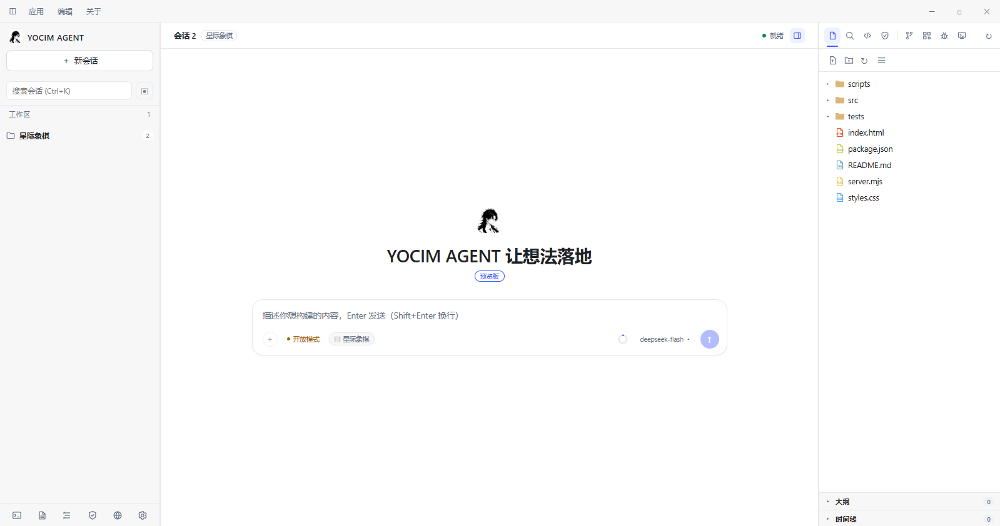

# YOCIM AGENT

[English](../README.md) | [中文](README.zh-CN.md) | [日本語](README.ja.md) | [한국어](README.ko.md) | [Español](README.es.md) | [Português (Brasil)](README.pt-BR.md)

로컬 우선 데스크톱 AI 코딩 어시스턴트(Electron + Vue 3 + TypeScript)입니다. 로컬 워크스페이스를 선택하고 모델과 대화하며, 승인 후 파일을 읽고 수정하거나 통제된 명령을 실행하도록 할 수 있습니다.



## 기능

- **다중 모델 지원**: DeepSeek, Qwen, BigModel, Kimi, MiniMax, Tencent Cloud, Alibaba Cloud, SiliconFlow, Volcano Engine, ChatGPT, Claude, Gemini, Grok, 로컬 Ollama 및 사용자 지정 엔드포인트를 지원합니다. 설정에서 추가하고 입력창 오른쪽 아래에서 전환합니다(프로바이더별로 그룹화, 모델 이름만 표시, 선택된 항목은 초록색 채워진 원으로 표시).
- **여섯 개 언어**: 중국어(간체), 영어, 일본어, 한국어, 스페인어, 브라질 포르투갈어를 지원합니다. 첫 실행 시 언어를 묻고 이어서 Model 설정을 열어 API Key 입력을 안내하며, 이 과정은 한 번만 진행됩니다. 언제든지 설정 → 외관 → 인터페이스 언어에서 변경할 수 있습니다(재시작 없이 즉시 적용).
- **탭형 설정**: Billing, Models, Search, Image Generation, Appearance, Storage, Browser. 승인 모드(Manual / Auto / Open)는 입력창 왼쪽 아래에서 전환되며 유지됩니다.
- **3분할 워크스페이스**: 왼쪽은 프로젝트 기반 세션 목록, 가운데는 순수 채팅 영역, 오른쪽은 8개 뷰 아이콘으로 구성된 활동 표시줄(Files / Search / Editor / Audit / Source Control / Extensions / Debug / Remote)입니다. 사이드 패널은 접을 수 있고 드래그로 크기를 조절할 수 있으며, 상태는 재시작 후에도 유지됩니다.
- **AI가 조작하는 브라우저**: 채팅 열 하단 도구 영역에 Terminal / Browser 탭이 있습니다(높이를 공유하며 크기 조절 가능). 에이전트는 얇은 CDP 프리미티브(`browser_cdp` / `browser_wait`)를 통해 내장된 가시적 Chromium 뷰를 구동합니다. 즉 탐색, 스크린샷, DOM/제목 읽기, 입력 좌표 전달, 조건 대기가 가능합니다. 뷰 내부 콘솔은 Console / Network / 예외 / 추가 전용 작업 감사를 통합하며 AI 일시정지 / 인수 / 재개 제어를 제공합니다. 브라우저 컨텍스트는 세션별로 격리되고 Runtime.evaluate는 Node/Electron과 격리되어 샌드박스됩니다.
- **워크스페이스 전체 검색 및 바꾸기**: 스트리밍 결과, 취소, include/exclude, 대소문자/전체 단어/정규식 옵션, 해시 충돌 검사를 포함한 바꾸기 미리보기, 타임라인 롤백을 제공합니다(ripgrep을 우선 사용하고 없을 때 내장 검색 엔진으로 대체).
- **Monaco 다중 탭 편집기**: 미리보기/고정 탭, `Ctrl+S` 저장, 변경(dirty) 상태, 외부 변경 충돌(덮어쓰기 / 다시 로드 / 다른 이름으로 저장), 이미지 미리보기, 선택 영역에서 "채팅에 추가"를 지원합니다.
- **프로젝트 및 세션**: 하나의 워크스페이스 = 하나의 프로젝트이며 프로젝트당 여러 세션을 가질 수 있습니다. 검색, 고정, 보관/보관 해제, 프로젝트 간 이동을 지원합니다. 세션과 프로젝트 관련 작업은 컨텍스트 메뉴에 있습니다.
- **어시스턴트 메시지**: Markdown 렌더링(marked + DOMPurify)을 지원합니다. 도구 호출은 확장 가능한 단계 타임라인으로 표시되고 승인 카드가 인라인으로 나타납니다. 기본 라이트 테마와 순수 검정 다크 테마를 제공하며, 상태 표시줄은 기본적으로 한 줄로 접혀 있고 펼칠 수 있습니다.
- **승인 환경**: 파일 쓰기 승인 카드에는 구문 강조 diff 미리보기가 포함됩니다(`edit_file` 패치의 모든 hunk를 한 번에 표시). "세션에서 허용 / 프로젝트에서 허용" 규칙은 이후 동일한 승인을 건너뜁니다(허용 목록과 위험한 명령은 규칙으로 우회할 수 없으며, 규칙 이름은 감사 로그에 기록됩니다). 실행 전에 파일이 외부에서 수정되었는지 다시 확인합니다.
- **작업 계획**: 에이전트는 `update_plan`을 통해 채팅 위에 계획 카드를 유지합니다(todo / in progress / done + 진행 표시줄). 라운드 한도에 도달하면 실행이 자동으로 일시정지되고 클릭 한 번으로 재개할 수 있습니다. 라운드 한도는 적응형입니다(읽기 전용 6 / 단일 파일 20 / 다중 파일 60).
- **컨텍스트 관리**: 모델 버튼 왼쪽의 사용량 링(마우스를 올리면 사용량/윈도 확인, 클릭하면 수동 압축). 윈도의 80%에 도달하면 이전 내용이 자동으로 구조화된 요약으로 압축됩니다(95% 초과 시 강제 트림). 윈도 기본값은 200K이며 모델 메뉴에서 200K~1000K로 조정할 수 있습니다. 추론 강도도 조정할 수 있습니다(기본 / 낮음 / 중간 / 높음, 프로토콜별로 매핑). 모델 측 대화 스트림(도구 호출 및 결과 포함)은 SQLite에 저장되어 라운드 간에 완전히 재생됩니다. 압축은 모델에 전송되는 내용에만 영향을 주며 채팅 기록에는 영향을 주지 않습니다. 읽기 전용 도구는 동시에 실행되고(최대 4개), 쓰기 도구와 명령은 직렬로 실행됩니다.
- **프로젝트 규칙 및 구조 주입**: `AGENTS.md` / `.yocim/rules.md`가 기본 습관보다 우선하며, 가벼운 repo map이 첫 턴에 모델이 디렉터리 구조를 이해하도록 돕습니다. 현재 열려 있는 파일과 저장하지 않은 파일이 각 요청에 주입됩니다.
- **도구**: `list_dir`(glob 필터링 + 파일 크기/줄 수), `read_file`(줄 번호 + offset/limit 페이징), `search_files`(ripgrep, 정규식 / include / exclude / 컨텍스트 줄), `write_file`, `edit_file`(들여쓰기 허용 오차를 가진 원자적 다중 hunk 패치), `run_command`(허용 목록 + `.yocim/commands.json` 확장, 스트리밍 출력), `run_tests`(vitest/jest/pytest/go 자동 감지), `run_typecheck` / `run_lint`(간결한 file:line:col 형식), `get_git_diff`, `update_plan`(매 라운드 모델에 피드백되는 구조화된 계획).
- **감사 패널**: 통계 카드(전체 / 실패 / 승인 / 거부 호출), 도구 / 결과 / 승인 / 시간 범위 / 키워드 필터, 상세 드로어, 라이브 모드, JSON/CSV 내보내기(SQLite에 저장, DB v4).
- **소스 제어**: 시스템 Git 감지(없을 때 설치 안내), 스테이징됨 / 변경됨 / 추적되지 않음 그룹, 스테이지 및 커밋, 브랜치 전환/생성, pull(`--ff-only`) / push / publish, diff 뷰어, 변경 사항 버리기 시 2차 확인, 민감 정보가 마스킹된 Git 출력, 변경 수 배지.
- **그래픽 커밋 그래프**: 세로 레인과 상태 점(병합 커밋은 빈 원, HEAD는 글로우), 커밋에 연결된 브랜치 / 리모트 / 태그 캡슐, conventional 접두사 색상. 커밋을 클릭하면 추가/삭제 줄 수와 함께 변경된 파일 목록이 펼쳐지고, 다시 클릭하면 접힙니다.
- **작업 실행**: npm / pnpm / yarn을 자동 감지하고 `package.json` 스크립트를 나열합니다. `.yocim/tasks.json`으로 사용자 지정 명령을 정의할 수 있습니다. 출력은 점진적으로 스트리밍되고 작업을 중지할 수 있으며(프로세스 트리 종료), 사용자 지정 명령은 처음 실행할 때 전체 확인이 필요합니다.
- **Node.js 디버깅**: `.yocim/launch.json`(`${workspaceFolder}` / `${file}` / `${env:NAME}` 변수 지원) 또는 `package.json` `main`에서 제로 구성으로 시작합니다. 편집기 글리프 여백의 중단점 및 조건부 중단점, 계속 / 일시정지 / 단계 건너뛰기 / 단계 진입 / 단계 종료 / 재시작 / 중지, 변수 트리, 조사식 표현식, 호출 스택, 디버그 콘솔, 현재 줄 강조를 제공합니다. 첫 실행 시 전체 명령을 확인해야 하며 출력은 민감 정보가 마스킹됩니다.
- **원격 워크스페이스(WSL / SSH)**: 대상을 관리하고 환경을 점검한 뒤 오른쪽 패널에서 직접 찾아보기 / 편집 / 검색 / Git / 작업 실행을 합니다. WSL은 `\\wsl.localhost` UNC 경로와 `wsl.exe --exec`를 사용하고, SSH는 내장 `ssh2`(SFTP + exec)를 사용하며, TOFU 호스트 지문 검증과 `safeStorage`로 암호화된 비밀번호를 지원합니다.
- **확장(1차 계층)**: 확장 코드를 실행하지 않습니다. 로컬 디렉터리 / `.vsix` / VS Code 확장 디렉터리에서 가져오기, 활성화/비활성화, 제거, 세부 정보 보기를 지원합니다. 호환성은 "선언형만 / 부분 / 호환되지 않음"으로 등급이 매겨지며, 호환되지 않는 확장은 기본적으로 비활성화됩니다. 선언형 스니펫 기여는 편집기 완성 항목으로 등록됩니다.
- **영속성**: 세션 / 메시지 / 설정 / 프로젝트 상태가 재시작 후에도 유지됩니다. 세션 이름 변경, 삭제, Markdown 내보내기를 지원합니다. 메인 프로세스 파일 로깅과 크래시 처리를 제공합니다.

## 인터페이스 및 키보드 단축키

- **왼쪽**: 상단에 브랜드와 "새 세션", 그 아래에 검색, 워크스페이스 개수, 고정 섹션, 프로젝트 그룹이 있습니다. 세션을 마우스 오른쪽 버튼으로 클릭하면 이름 변경 / 내보내기 / 고정 / 보관 / 이동 / 삭제가 가능하고, 프로젝트를 마우스 오른쪽 버튼으로 클릭하면 세션 생성 / 이름 변경이 가능합니다.
- **가운데**: 빈 세션은 환영 상태와 큰 입력창을 보여줍니다. 스트리밍 응답은 중지할 수 있습니다. 도구 단계는 "N단계 실행됨 · Xs"로 접히고 펼치면 인자와 결과를 볼 수 있습니다. 실패 시 재시도 가능한 오류 카드가 표시됩니다.
- **오른쪽**: 8개 아이콘 뷰가 있습니다. 파일을 클릭하면 편집기로 전환되고, 검색 결과로 이동해 선택할 수 있습니다. 분할선은 드래그하여 크기를 조절하거나, 더블 클릭하여 초기화하거나, 포커스 상태에서 방향키로 미세 조정할 수 있습니다.
- **제목 표시줄**: "Application" 메뉴에서 워크스페이스 / 테마를 전환하고 설정을 엽니다. "Edit" 메뉴에서 세션 생성/검색, 워크스페이스 접기, 상태 표시줄 전환을 할 수 있습니다. 언어 설정은 설정 → 외관에 있습니다.

| 단축키         | 동작                      |
| -------------- | ------------------------- |
| `Ctrl+B`       | 세션 사이드바 토글        |
| `Ctrl+Shift+B` | 워크스페이스 패널 토글    |
| `Ctrl+N`       | 새 세션                   |
| `Ctrl+K`       | 세션 검색으로 포커스      |
| `Ctrl+J`       | 상태 표시줄 펼치기 / 접기 |
| `Ctrl+S`       | 현재 편집기 파일 저장     |

> macOS에서는 `Ctrl` 대신 `Cmd`를 사용합니다.

## 승인 모드

| 모드 | 동작                                                           |
| ---- | -------------------------------------------------------------- |
| 수동 | 파일 쓰기와 명령 모두 승인이 필요합니다(기본값)                |
| 자동 | 파일 쓰기는 자동으로 승인되고, 명령은 여전히 확인합니다        |
| 개방 | 파일 쓰기와 명령이 자동 승인되며 승인 카드가 표시되지 않습니다 |

개방 모드에서도 워크스페이스 경로 가드, 명령 허용 목록, 위험 명령 차단의 제약을 받습니다. 승인 모드는 이러한 보안 경계를 절대 우회하지 않습니다.

## 요구 사항

- Node.js >= 22.12 (이 저장소에서는 Node 24 / npm 11에서 검증)
- Windows 10+ (주 검증 플랫폼), macOS, Linux
- 네이티브 빌드 툴체인이 필요하지 않습니다(데이터베이스는 Electron/Node 내장 `node:sqlite` 사용)

## 설치 및 개발

```powershell
npm install
npm run dev
```

Electron 런타임 다운로드가 실패하는 경우(일부 네트워크에서 흔함), 미러를 사용해 설치합니다:

```powershell
$env:ELECTRON_MIRROR='https://npmmirror.com/mirrors/electron/'
node node_modules/electron/install.js
```

| 명령                  | 설명                                                   |
| --------------------- | ------------------------------------------------------ |
| `npm run dev`         | 개발 창 시작(Vite HMR)                                 |
| `npm run typecheck`   | TypeScript / Vue 타입 검사                             |
| `npm run lint`        | ESLint                                                 |
| `npm run test`        | Vitest 단위 테스트                                     |
| `npm run build`       | main / preload / renderer 빌드                         |
| `npx playwright test` | Electron e2e 스모크 테스트(먼저 빌드 필요)             |
| `npm run e2e`         | 빌드 + e2e                                             |
| `npm run package`     | 현재 플랫폼용 설치 프로그램 빌드(`release/<version>/`) |
| `npm run package:dir` | 압축 해제된 디렉터리만 빌드(패키징 디버깅용)           |

## 모델 설정

**Mock Provider**가 기본으로 사용되며 네트워크 요청을 하지 않습니다. 데모 명령: `/tool read <path>`(승인 없음), `/tool write <path>` 및 `/tool command <command>`(승인 발생).

실제 모델을 연결하려면: 제목 표시줄 "Application" → "Settings…" → "Models" → "Add Provider"에서 프리셋을 선택한 뒤 Base URL, 모델 목록, API key를 입력합니다. 저장하면 해당 프로바이더로 자동 전환됩니다. 입력창 오른쪽 아래의 모델 버튼으로 언제든지 프로바이더/모델을 전환할 수 있습니다.

내장 엔드포인트:

| 프로바이더       | Base URL                                            | 프로토콜                    |
| ---------------- | --------------------------------------------------- | --------------------------- |
| DeepSeek         | `https://api.deepseek.com/v1`                       | OpenAI 호환                 |
| Qwen (Tongyi)    | `https://dashscope.aliyuncs.com/compatible-mode/v1` | OpenAI 호환                 |
| BigModel (Zhipu) | `https://open.bigmodel.cn/api/paas/v4`              | OpenAI 호환                 |
| Kimi (Moonshot)  | `https://api.moonshot.cn/v1`                        | OpenAI 호환                 |
| MiniMax          | `https://api.minimaxi.com/v1`                       | OpenAI 호환                 |
| Tencent Cloud    | `https://api.hunyuan.cloud.tencent.com/v1`          | OpenAI 호환                 |
| Alibaba Cloud    | `https://dashscope.aliyuncs.com/compatible-mode/v1` | OpenAI 호환                 |
| SiliconFlow      | `https://api.siliconflow.cn/v1`                     | OpenAI 호환                 |
| Volcano Engine   | `https://ark.cn-beijing.volces.com/api/v3`          | OpenAI 호환                 |
| ChatGPT (OpenAI) | `https://api.openai.com/v1`                         | OpenAI 호환                 |
| Claude           | `https://api.anthropic.com/v1`                      | Anthropic Messages          |
| Gemini           | `https://generativelanguage.googleapis.com/v1beta`  | Gemini GenerateContent      |
| Grok             | `https://api.x.ai/v1`                               | OpenAI 호환                 |
| 로컬 Ollama      | `http://localhost:11434/v1`                         | OpenAI 호환(키 없음)        |
| 사용자 지정      | 직접 입력                                           | OpenAI / Anthropic / Gemini |

설정 탭: Billing(DeepSeek 잔액 + 직접 입력한 단가를 기준으로 프로바이더/모델별 토큰 사용량), Models, Search(Tavily 키 — `web_search`를 활성화하며, 키가 없으면 해당 도구는 숨겨짐), Image Generation(Zhipu 키, 기본 무료 `cogview-3-flash` — `generate_image`를 활성화하며 사용자 지정 OpenAI 이미지 형식 엔드포인트 옵션 제공), Appearance(테마 / 글꼴 크기 / 자동 줄바꿈 / 코드 미니맵), Storage(데이터 디렉터리 확인 및 변경, 재시작 후 적용), Browser(AI 브라우저 도구 활성화/비활성화, 헤드리스 모드, 유휴 시 회수, Runtime.evaluate, 위험 경고와 함께 일상 프로필 재사용 명시적 선택).

API key 처리: 각 프로바이더의 키는 `settings`에 저장되기 전에 Electron `safeStorage`로 암호화되며 평문으로 저장되지 않습니다. 렌더러는 `hasApiKey`만 읽을 수 있습니다. 폴백으로 환경 변수도 지원합니다(`DEEPSEEK_API_KEY`, `DASHSCOPE_API_KEY`, `OPENAI_API_KEY`, `ANTHROPIC_API_KEY`, `GEMINI_API_KEY`, `XAI_API_KEY`, `TAVILY_API_KEY`, `ZHIPU_API_KEY` 등).

## 보안

- 렌더러는 Node/fs/child_process에 접근할 수 없으며 preload 허용 목록을 통해서만 메인 프로세스를 호출할 수 있습니다. IPC 핸들러는 `senderFrame`을 검증하고 애플리케이션 페이지가 아니면 `E_FORBIDDEN`을 반환합니다.
- 모든 파일 경로는 `..`, 절대 경로, 심볼릭 링크 이탈을 차단하는 realpath 가드를 거칩니다. 파일 쓰기와 명령은 승인이 필요하며, 명령은 허용 목록과 위험 패턴 검사로 제한됩니다(60초 타임아웃, 출력 64KB 절단).
- 감사 로그는 추가 전용이며 시간, 도구, 인자 요약, 결과, 승인 상태를 기록합니다.
- Git 작업은 셸 없이 `spawn('git', args)`를 사용하는 메인 프로세스 `GitService`를 통해 수행됩니다. 강제 push 없음, 훅 건너뛰기 없음, pull은 기본적으로 `--ff-only`, Git 출력의 URL/자격 증명/토큰은 마스킹되며, 자격 증명은 시스템 Git Credential Manager에 위임됩니다.
- 작업과 디버그 세션도 인자 배열 `spawn`을 사용합니다(Windows에서는 `.cmd`/`.bat`를 `cmd.exe /d /s /c`로 감쌉니다). 사용자 지정 작업과 launch 구성은 첫 실행 시 전체 확인이 필요합니다. `launch.json`의 `program`/`cwd`는 워크스페이스를 벗어날 수 없으며, 출력은 마스킹되고 작업당 최대 512KB로 제한되며 동시 작업은 최대 4개입니다.
- 원격 워크스페이스: WSL은 셸 없이 배열 인자와 함께 `wsl.exe --exec`로 실행됩니다. SSH는 내장 `ssh2`를 사용하며 개인 키 / 비밀번호 / ssh-agent 인증을 지원합니다. 비밀 정보는 `safeStorage`로 암호화되어 저장되며(렌더러는 `hasSecret`만 앎), 호스트 지문은 첫 사용 시 TOFU로 검증되고 변경되면 차단됩니다. 원격 경로는 `..` 이탈 여부를 검사합니다. 원격 디버깅과 일괄 바꾸기는 UI에서 명시적으로 비활성화됩니다.
- 1차 확장 계층은 **확장 코드를 전혀 실행하지 않습니다**. 선언형 기여만 파싱합니다. VSIX 아카이브는 zip64와 경로 이탈을 거부하는 내장 최소 zip 리더로 풀립니다. `main`/`browser`, `debuggers`, 또는 확장 의존성을 선언한 확장은 "호환되지 않음"으로 표시되어 비활성 상태로 유지됩니다.

## 데이터 위치

Electron의 `userData` 디렉터리 아래(Windows에서는 일반적으로 `%APPDATA%\YOCIM AGENT`):

- `yocim.db`: 프로젝트, 세션, 메시지, 도구 호출, 설정, 감사, 토큰 사용량
- `workspace.json`: 마지막으로 연 워크스페이스
- `logs/main.log`: 메인 프로세스 로그(2MB 초과 시 `main.old.log`로 로테이션)

"설정 → 저장소"에서 사용자 지정 디렉터리를 지정할 수 있습니다(데이터베이스, 로그, 타임라인 스냅샷, 확장이 함께 이동). 변경 사항은 재시작 후 적용됩니다.

## 패키징

```powershell
$env:ELECTRON_MIRROR='https://npmmirror.com/mirrors/electron/'
$env:ELECTRON_BUILDER_BINARIES_MIRROR='https://npmmirror.com/mirrors/electron-builder-binaries/'
npm run package
```

- Windows 산출물: `release/0.1.9/YOCIM.AGENT-0.1.9-x64-setup.exe` 및 `release/0.1.9/win-unpacked/`
- 번들 ripgrep: 14.1.1 바이너리는 패키징 전에 CI가 `resources/ripgrep/`로 다운로드하고 `extraResources`로 복사합니다. 로컬 빌드에서는 `rg`/`rg.exe`를 수동으로 해당 위치에 두거나(gitignore됨) `YOCIM_RIPGREP_PATH`를 설정할 수 있습니다. 없으면 PATH의 `rg`와 내장 JS 검색으로 대체됩니다
- 런타임 의존성: `zod`와 `ssh2`(`asn1` / `bcrypt-pbkdf` / `tweetnacl` / `safer-buffer` 포함)는 외부화되어 asar에 패킹됩니다. `cpu-features`는 선택적 네이티브 가속기로 컴파일 및 패키징되지 않습니다. `npmRebuild: false`는 프로젝트 경로에 공백이 있을 때 node-gyp 실패를 방지합니다
- 앱 아이콘: `build/icon.png`(Windows / Linux, `public/image/yocim.png`에서 복사) 및 `build/icon.icns`(macOS). 코드 서명은 아직 구성되지 않아 설치 중 SmartScreen 경고가 표시될 수 있습니다.

## 라이선스

MIT License. [LICENSE](../LICENSE)를 참조합니다.
