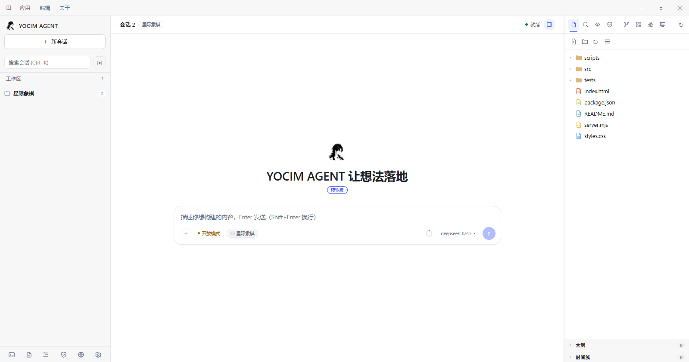

# YOCIM AGENT

[English](../README.md) | [中文](README.zh-CN.md) | [日本語](README.ja.md) | [한국어](README.ko.md) | [Español](README.es.md) | [Português (Brasil)](README.pt-BR.md)

Um assistente de programação com IA para desktop que prioriza o local (Electron + Vue 3 + TypeScript). Escolha uma área de trabalho local, converse com um modelo e deixe que ele leia/modifique arquivos e execute comandos controlados após a sua aprovação.



## Recursos

- **Suporte a múltiplos modelos**: DeepSeek, Qwen, BigModel, Kimi, MiniMax, Tencent Cloud, Alibaba Cloud, SiliconFlow, Volcano Engine, ChatGPT, Claude, Gemini, Grok, Ollama local e endpoints personalizados. Adicione-os em Configurações e alterne no canto inferior direito do compositor (agrupados por provedor, apenas o nome do modelo, item selecionado marcado com um círculo verde preenchido).
- **Seis idiomas**: chinês simplificado, inglês, japonês, coreano, espanhol e português do Brasil. Na primeira execução, o aplicativo pergunta o idioma e em seguida abre as configurações de Modelos para orientar você a inserir uma API Key; isso acontece apenas uma vez. Altere a qualquer momento em Configurações → Aparência → Idioma da interface (tem efeito imediato, sem reiniciar).
- **Configurações em abas**: Faturamento, Modelos, Busca, Geração de imagens, Aparência, Armazenamento e Navegador. O modo de aprovação (Manual / Auto / Aberto) é alternado no canto inferior esquerdo do compositor e persistido.
- **Área de trabalho de três painéis**: lista de sessões organizada por projeto à esquerda, uma área de chat pura no centro e uma barra de atividades com 8 visualizações de ícone à direita (Arquivos / Busca / Editor / Auditoria / Controle de código-fonte / Extensões / Depuração / Remoto). Os painéis laterais podem ser recolhidos e redimensionados por arrastar, com o estado persistido entre reinicializações.
- **Navegador operável por IA**: a área de ferramentas inferior da coluna de chat tem abas Terminal / Navegador (altura redimensionável compartilhada). O agente controla uma visualização Chromium incorporada e visível por meio de primitivas CDP enxutas (`browser_cdp` / `browser_wait`) — navegar, capturar tela, ler DOM/título, despachar coordenadas de entrada e aguardar condições. Um console dentro da visualização agrega Console / Rede / exceções / uma auditoria de ações somente de acréscimo, com controles de pausar IA / assumir o controle / retomar. Os contextos de navegador são isolados por sessão, e Runtime.evaluate é isolado por sandbox do Node/Electron.
- **Busca e substituição em toda a área de trabalho**: resultados em streaming, cancelamento, incluir/excluir, opções de maiúsculas/palavra inteira/regex, pré-visualização de substituição com verificação de conflito por hash e reversão pela linha do tempo (ripgrep primeiro, com fallback para o mecanismo de busca integrado).
- **Editor Monaco com múltiplas abas**: abas em pré-visualização/fixadas, salvamento com `Ctrl+S`, estado alterado, conflitos de alteração externa (sobrescrever / recarregar / salvar como), pré-visualização de imagens e "Adicionar ao chat" a partir de uma seleção.
- **Projetos e sessões**: uma área de trabalho = um projeto, com várias sessões por projeto; buscar, fixar, arquivar/desarquivar e mover entre projetos. As ações de sessão e de projeto ficam nos menus de contexto.
- **Mensagens do assistente**: renderização Markdown (marked + DOMPurify); chamadas de ferramentas exibidas como linhas do tempo de etapas expansíveis, com cartões de aprovação inline. Tema claro por padrão, além de um tema escuro preto puro; a barra de status recolhe para uma única linha por padrão e pode ser expandida.
- **Experiência de aprovação**: os cartões de aprovação de escrita de arquivo incluem uma pré-visualização de diff com destaque de sintaxe (todos os hunks de um patch `edit_file` de uma vez). As regras "Permitir na sessão / Permitir no projeto" dispensam aprovações idênticas futuras (comandos na allowlist e comandos perigosos não podem ser ignorados pelas regras; o nome da regra é registrado no log de auditoria). Os arquivos são verificados novamente quanto a modificações externas antes da execução.
- **Planejamento de tarefas**: o agente mantém um cartão de plano acima do chat via `update_plan` (a fazer / em andamento / concluído + barra de progresso). Atingir o limite de rodadas pausa automaticamente a execução, que pode ser retomada com um clique. Os limites de rodadas são adaptativos (6 somente leitura / 20 arquivo único / 60 múltiplos arquivos).
- **Gerenciamento de contexto**: um anel de uso à esquerda do botão de modelo (passe o mouse para ver usado/janela, clique para compactar manualmente). Conteúdo antigo é compactado automaticamente em um resumo estruturado a 80% da janela (corte rígido acima de 95%). A janela padrão é 200K e é ajustável de 200K a 1000K no menu do modelo; o esforço de raciocínio também é ajustável (padrão / baixo / médio / alto, mapeado por protocolo). Os streams de conversa do lado do modelo (incluindo chamadas de ferramentas e resultados) são persistidos no SQLite e totalmente reproduzidos entre rodadas — a compactação afeta apenas o que é enviado ao modelo, nunca o histórico do chat. Ferramentas somente leitura são executadas em paralelo (até 4), enquanto ferramentas de escrita e comandos são executados em série.
- **Regras de projeto e injeção de estrutura**: `AGENTS.md` / `.yocim/rules.md` têm precedência sobre os hábitos padrão, e um mapa leve do repositório ajuda o modelo a entender o layout de diretórios na primeira rodada. Os arquivos abertos no momento e os não salvos são injetados a cada requisição.
- **Ferramentas**: `list_dir` (filtragem glob + tamanho/contagem de linhas de arquivo), `read_file` (números de linha + paginação por offset/limit), `search_files` (ripgrep, regex / incluir / excluir / linhas de contexto), `write_file`, `edit_file` (patches atômicos com múltiplos hunks e tolerância a indentação), `run_command` (allowlist + extensões em `.yocim/commands.json`, saída em streaming), `run_tests` (detecta automaticamente vitest/jest/pytest/go), `run_typecheck` / `run_lint` (formato compacto arquivo:linha:coluna), `get_git_diff`, `update_plan` (plano estruturado realimentado ao modelo a cada rodada).
- **Painel de auditoria**: cartões de estatísticas (chamadas totais / com falha / aprovadas / negadas), filtros por ferramenta / resultado / aprovação / intervalo de tempo / palavra-chave, gaveta de detalhes, modo ao vivo e exportação em JSON/CSV (persistido no SQLite, DB v4).
- **Controle de código-fonte**: detecção do Git do sistema (com dica de instalação caso esteja ausente), grupos de arquivos em stage / alterados / não rastreados, stage e commit, troca/criação de branch, pull (`--ff-only`) / push / publish, visualizador de diff, segunda confirmação para descartar alterações, saída do Git com dados sensíveis mascarados e um selo com a contagem de alterações.
- **Grafo de commits gráfico**: faixas verticais com pontos de status (vazios para commits de merge, brilhantes para HEAD), cápsulas de branch / remoto / tag anexadas aos seus commits e coloração por prefixo convencional. Clique em um commit para expandir sua lista de arquivos alterados com contagens de inserções/exclusões; clique novamente para recolher.
- **Tarefas de execução**: detecta automaticamente npm / pnpm / yarn e lista os scripts do `package.json`; `.yocim/tasks.json` pode definir comandos personalizados. A saída flui incrementalmente, as tarefas podem ser interrompidas (encerrando a árvore de processos), e um comando personalizado deve ser confirmado por inteiro na primeira execução.
- **Depuração Node.js**: inicialização sem configuração a partir de `.yocim/launch.json` (com as variáveis `${workspaceFolder}` / `${file}` / `${env:NAME}`) ou do `main` do `package.json`. Breakpoints e breakpoints condicionais na margem de glifos do editor, continuar / pausar / avançar / entrar / sair / reiniciar / parar, árvore de variáveis, expressões de observação, pilha de chamadas, console de depuração e destaque da linha atual. O comando completo deve ser confirmado na primeira inicialização; a saída tem dados sensíveis mascarados.
- **Áreas de trabalho remotas (WSL / SSH)**: gerencie destinos e sonde ambientes, depois navegue / edite / pesquise / use Git / execute tarefas diretamente no painel direito. O WSL usa caminhos UNC `\\wsl.localhost` além de `wsl.exe --exec`; o SSH usa o `ssh2` integrado (SFTP + exec), com verificação de impressão digital do host via TOFU e senhas criptografadas via `safeStorage`.
- **Extensões (primeira camada)**: nenhum código de extensão é executado. Importe de diretórios locais / `.vsix` / do diretório de extensões do VS Code, ative/desative, desinstale e veja detalhes. A compatibilidade é classificada como "somente declarativa / parcial / incompatível", com extensões incompatíveis desativadas por padrão. Contribuições declarativas de snippets são registradas como sugestões do editor.
- **Persistência**: sessões / mensagens / configurações / estado do projeto sobrevivem às reinicializações; as sessões podem ser renomeadas, excluídas e exportadas para Markdown. Logging em arquivo e tratamento de falhas no processo principal.

## Interface e atalhos de teclado

- **Esquerda**: marca e "Nova sessão" no topo, depois busca, contagem de áreas de trabalho, seção de fixados e grupos de projetos. Clique com o botão direito em uma sessão para renomear / exportar / fixar / arquivar / mover / excluir; clique com o botão direito em um projeto para criar uma sessão / renomear.
- **Centro**: sessões vazias mostram um estado de boas-vindas e um compositor grande; respostas em streaming podem ser interrompidas; as etapas de ferramentas recolhem em "N etapas executadas · Xs" e expandem para mostrar argumentos e resultados; falhas mostram um cartão de erro com opção de tentar novamente.
- **Direita**: as 8 visualizações de ícone; clicar em um arquivo muda para o editor, e um resultado de busca pode ser acessado e selecionado. O divisor pode ser arrastado para redimensionar, clicado duas vezes para redefinir ou ajustado com as teclas de seta quando focado.
- **Barra de título**: o menu "Aplicativo" alterna a área de trabalho / o tema e abre as Configurações; o menu "Editar" cria/pesquisa sessões, recolhe a área de trabalho e alterna a barra de status. O idioma fica em Configurações → Aparência.

| Atalho         | Ação                                         |
| -------------- | -------------------------------------------- |
| `Ctrl+B`       | Mostrar/ocultar a barra lateral de sessões   |
| `Ctrl+Shift+B` | Mostrar/ocultar o painel da área de trabalho |
| `Ctrl+N`       | Nova sessão                                  |
| `Ctrl+K`       | Focar a busca de sessões                     |
| `Ctrl+J`       | Expandir / recolher a barra de status        |
| `Ctrl+S`       | Salvar o arquivo atual do editor             |

> No macOS, use `Cmd` em vez de `Ctrl`.

## Modos de aprovação

| Modo   | Comportamento                                                                         |
| ------ | ------------------------------------------------------------------------------------- |
| Manual | Tanto a escrita de arquivos quanto os comandos exigem aprovação (padrão)              |
| Auto   | Escritas de arquivo são aprovadas automaticamente; comandos ainda perguntam           |
| Aberto | Escritas de arquivo e comandos são aprovados automaticamente, sem cartão de aprovação |

O modo Aberto ainda está sujeito à proteção de caminho da área de trabalho, à allowlist de comandos e ao bloqueio de comandos perigosos — os modos de aprovação nunca ignoram essas fronteiras de segurança.

## Requisitos

- Node.js >= 22.12 (verificado neste repositório com Node 24 / npm 11)
- Windows 10+ (plataforma principal de validação), macOS e Linux
- Nenhuma toolchain de build nativa é necessária (o banco de dados usa o `node:sqlite` integrado do Electron/Node)

## Instalação e desenvolvimento

```powershell
npm install
npm run dev
```

Se o download do runtime do Electron falhar (comum em algumas redes), preencha-o usando um espelho:

```powershell
$env:ELECTRON_MIRROR='https://npmmirror.com/mirrors/electron/'
node node_modules/electron/install.js
```

| Comando               | Descrição                                                           |
| --------------------- | ------------------------------------------------------------------- |
| `npm run dev`         | Inicia a janela de desenvolvimento (Vite HMR)                       |
| `npm run typecheck`   | Verificação de tipos TypeScript / Vue                               |
| `npm run lint`        | ESLint                                                              |
| `npm run test`        | Testes unitários Vitest                                             |
| `npm run build`       | Compila main / preload / renderer                                   |
| `npx playwright test` | Testes e2e de fumaça do Electron (compile antes)                    |
| `npm run e2e`         | Build + e2e                                                         |
| `npm run package`     | Cria um instalador para a plataforma atual (`release/<version>/`)   |
| `npm run package:dir` | Cria apenas um diretório desempacotado (depuração do empacotamento) |

## Configuração de modelos

O **Mock Provider** é usado por padrão e não faz requisições de rede. Comandos de demonstração: `/tool read <path>` (sem aprovação), `/tool write <path>` e `/tool command <command>` (acionam aprovação).

Para conectar um modelo real: barra de título "Aplicativo" → "Configurações…" → "Modelos" → "Adicionar provedor", escolha um preset e preencha o Base URL, a lista de modelos e a API key. Salvar muda automaticamente para esse provedor. Use o botão de modelo no canto inferior direito do compositor para alternar entre provedores/modelos a qualquer momento.

Endpoints integrados:

| Provedor         | Base URL                                            | Protocolo                         |
| ---------------- | --------------------------------------------------- | --------------------------------- |
| DeepSeek         | `https://api.deepseek.com/v1`                       | Compatível com OpenAI             |
| Qwen (Tongyi)    | `https://dashscope.aliyuncs.com/compatible-mode/v1` | Compatível com OpenAI             |
| BigModel (Zhipu) | `https://open.bigmodel.cn/api/paas/v4`              | Compatível com OpenAI             |
| Kimi (Moonshot)  | `https://api.moonshot.cn/v1`                        | Compatível com OpenAI             |
| MiniMax          | `https://api.minimaxi.com/v1`                       | Compatível com OpenAI             |
| Tencent Cloud    | `https://api.hunyuan.cloud.tencent.com/v1`          | Compatível com OpenAI             |
| Alibaba Cloud    | `https://dashscope.aliyuncs.com/compatible-mode/v1` | Compatível com OpenAI             |
| SiliconFlow      | `https://api.siliconflow.cn/v1`                     | Compatível com OpenAI             |
| Volcano Engine   | `https://ark.cn-beijing.volces.com/api/v3`          | Compatível com OpenAI             |
| ChatGPT (OpenAI) | `https://api.openai.com/v1`                         | Compatível com OpenAI             |
| Claude           | `https://api.anthropic.com/v1`                      | Anthropic Messages                |
| Gemini           | `https://generativelanguage.googleapis.com/v1beta`  | Gemini GenerateContent            |
| Grok             | `https://api.x.ai/v1`                               | Compatível com OpenAI             |
| Ollama local     | `http://localhost:11434/v1`                         | Compatível com OpenAI (sem chave) |
| Personalizado    | Informe o seu próprio                               | OpenAI / Anthropic / Gemini       |

Abas de configurações: Faturamento (saldo DeepSeek + uso de tokens por provedor/modelo, com preços unitários inseridos manualmente), Modelos, Busca (chave Tavily — habilita `web_search`; a ferramenta fica oculta quando nenhuma chave é definida), Geração de imagens (chave Zhipu, `cogview-3-flash` gratuito por padrão — habilita `generate_image`, com opção de endpoint personalizado no formato de imagem da OpenAI), Aparência (tema / tamanho da fonte / quebra de linha / minimapa de código), Armazenamento (visualizar e alterar o diretório de dados, com efeito após reiniciar) e Navegador (ativar/desativar as ferramentas de navegador de IA, modo headless, reciclagem por inatividade, Runtime.evaluate e adesão explícita para reutilizar seu perfil diário, com aviso de risco).

Manipulação de API key: a chave de cada provedor é criptografada com o `safeStorage` do Electron antes de ser armazenada em `settings` — nunca em texto puro; o renderer só pode ler `hasApiKey`. Variáveis de ambiente também são suportadas como alternativa (`DEEPSEEK_API_KEY`, `DASHSCOPE_API_KEY`, `OPENAI_API_KEY`, `ANTHROPIC_API_KEY`, `GEMINI_API_KEY`, `XAI_API_KEY`, `TAVILY_API_KEY`, `ZHIPU_API_KEY`, etc.).

## Segurança

- O renderer não tem acesso a Node/fs/child_process e só pode chamar o processo principal por meio da allowlist do preload; os handlers IPC validam `senderFrame` e retornam `E_FORBIDDEN` para páginas que não são da aplicação.
- Todos os caminhos de arquivo passam por uma proteção de realpath que bloqueia `..`, caminhos absolutos e escapes por symlink. Escritas de arquivo e comandos exigem aprovação, e os comandos são restritos por uma allowlist e verificações de padrões perigosos (timeout de 60s, truncamento de saída em 64KB).
- O log de auditoria é somente de acréscimo, registrando horário, ferramenta, resumo dos argumentos, resultado e status de aprovação.
- As operações do Git passam pelo `GitService` do processo principal usando `spawn('git', args)` sem shell. Sem force push, sem pular hooks, o pull usa `--ff-only` por padrão, a saída do Git tem URLs/credenciais/tokens mascarados e as credenciais são delegadas ao Git Credential Manager do sistema.
- Tarefas e sessões de depuração também usam `spawn` com array de argumentos (no Windows, `.cmd`/`.bat` são envolvidos com `cmd.exe /d /s /c`). Tarefas personalizadas e configurações de inicialização devem ser confirmadas por inteiro na primeira execução; `program`/`cwd` do `launch.json` não podem escapar da área de trabalho; a saída tem dados sensíveis mascarados, limitada a 512KB por tarefa, com no máximo 4 tarefas simultâneas.
- Áreas de trabalho remotas: o WSL é executado via `wsl.exe --exec` com argumentos em array e sem shell. O SSH usa o `ssh2` integrado com autenticação por chave privada / senha / ssh-agent; os segredos são salvos apenas criptografados com `safeStorage` (o renderer conhece apenas `hasSecret`); as impressões digitais do host são verificadas por TOFU no primeiro uso e bloqueadas se mudarem; caminhos remotos são verificados quanto a travessia `..`. Depuração remota e substituição em massa são explicitamente desativadas na interface.
- A primeira camada de extensões **não executa código de extensão**: apenas contribuições declarativas são analisadas. Arquivos VSIX são descompactados com um leitor zip mínimo integrado que rejeita zip64 e travessia de caminho; extensões que declaram `main`/`browser`, `debuggers` ou dependências de extensão são marcadas como "incompatíveis" e permanecem desativadas.

## Localização dos dados

No diretório `userData` do Electron (no Windows, tipicamente `%APPDATA%\YOCIM AGENT`):

- `yocim.db`: projetos, sessões, mensagens, chamadas de ferramentas, configurações, auditoria e uso de tokens
- `workspace.json`: a última área de trabalho aberta
- `logs/main.log`: log do processo principal (rotaciona para `main.old.log` acima de 2MB)

"Configurações → Armazenamento" pode apontar para um diretório personalizado (banco de dados, logs, snapshots da linha do tempo e extensões se movem juntos); a alteração tem efeito após reiniciar.

## Empacotamento

```powershell
$env:ELECTRON_MIRROR='https://npmmirror.com/mirrors/electron/'
$env:ELECTRON_BUILDER_BINARIES_MIRROR='https://npmmirror.com/mirrors/electron-builder-binaries/'
npm run package
```

- Artefatos do Windows: `release/0.1.9/YOCIM.AGENT-0.1.9-x64-setup.exe` e `release/0.1.9/win-unpacked/`
- ripgrep incluído: binários 14.1.1 baixados pela CI para `resources/ripgrep/` antes do empacotamento e copiados via `extraResources`; builds locais podem colocar `rg`/`rg.exe` ali manualmente (ignorado pelo git) ou definir `YOCIM_RIPGREP_PATH`. Usa como fallback o `rg` do PATH e a busca JS integrada quando ausente
- Dependências de runtime: `zod` e `ssh2` (com `asn1` / `bcrypt-pbkdf` / `tweetnacl` / `safer-buffer`) são externalizadas e empacotadas no asar; `cpu-features` é um acelerador nativo opcional que não é compilado nem empacotado; `npmRebuild: false` evita falhas do node-gyp quando o caminho do projeto contém espaços
- Ícones do app: `build/icon.png` (Windows / Linux, copiado de `public/image/yocim.png`) e `build/icon.icns` (macOS). A assinatura de código ainda não está configurada, então o SmartScreen pode avisar durante a instalação.

## Licença

Licença MIT. Consulte [LICENSE](../LICENSE).
